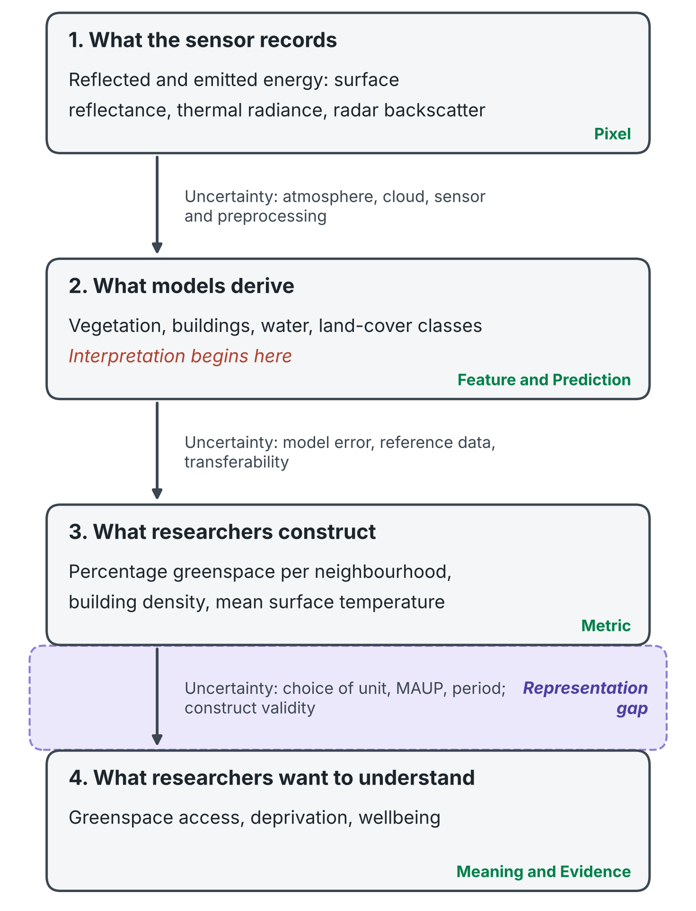

## Introduction

Satellite imagery provides an extraordinarily rich record of the Earth, but an image is not, by itself, a social science dataset. Satellites record physical characteristics of the Earth's surface, such as the amount of light reflected by vegetation, heat emitted from built surfaces, or signals returned from buildings and other features [@jensen2009remote; @campbell2011introduction]. Social scientists and policymakers, however, are usually interested in concepts such as access to greenspace, housing conditions, infrastructure provision, environmental exposure, vulnerability or economic development. The challenge is therefore to translate what a satellite can observe into information that helps us understand these social and policy questions. This distinction has long underpinned attempts to use remotely sensed observations as proxies for otherwise difficult-to-measure social and economic conditions [@elvidge1997relation].

Chapter 1 identified this translation, which Imago terms the pixel-to-metric challenge, as one of three barriers to the use of imagery in social research. It involves transforming the information contained in satellite pixels into measures that are meaningful, interpretable and useful for research and policy. Consider greenspace as a simple example. Satellite pixels contain information that can help distinguish vegetation from other surfaces. These pixels can be classified to produce a map of greenspace, which can then be used to calculate the percentage of greenspace within each neighbourhood. What begins as a physical measurement recorded by a satellite has therefore become a metric that can be combined with census, health or other social data to investigate questions such as inequalities in greenspace provision. The process can involve relatively simple measures, such as the Normalised Difference Vegetation Index (NDVI), which uses differences in red and near-infrared reflectance to characterise vegetation [@tucker1979red]. More complex approaches use machine learning and computer vision to identify features such as buildings, roads, water and vegetation and to derive information associated with socioeconomic conditions from patterns contained in imagery [@jean2016combining]. Recent advances in cloud computing have substantially increased the geographical scale at which these transformations can be undertaken [@gorelick2017google; @mutanga2019google; @zhao2021progress].

An important distinction, however, exists between what can be observed from space and what we ultimately want to understand about society. A satellite can detect characteristics of buildings, but it does not directly observe housing deprivation. It can identify vegetation, but it cannot tell us whether residents can access that greenspace, whether they feel safe using it, or whether it meets their needs. Similarly, night-time illumination has long been used as a remotely sensed proxy for population and economic activity [@elvidge1997relation], but light itself is not a direct measure of income or economic wellbeing. The subsequent use of satellite imagery alongside survey data and machine learning to estimate poverty illustrates both the potential and the importance of this distinction [@jean2016combining]. Imagery-derived indicators therefore depend on a chain of decisions that connects what a satellite observes to the social concept a researcher ultimately wants to understand.

This chapter explains how satellite images can be turned into useful information for research and policy. It first introduces a six-stage Pixel-to-Metric framework that organises the rest of the chapter. It then describes how satellite images are prepared for analysis and how different methods can be used to identify features such as vegetation, buildings, roads and water. These range from simple calculations to more advanced approaches that use artificial intelligence to recognise patterns in images. The chapter then explains how this information can be used to measure conditions across neighbourhoods, cities and regions, track changes over time, and be combined with information such as population statistics and census data. It also considers how researchers can check the reliability of these measurements, understand possible sources of error and recognise the limits of what satellites can tell us. The central message is that satellite imagery is not simply about identifying what is visible from space, but about turning those observations into reliable and meaningful information that can help answer important social and policy questions.

## Chapter objectives

This chapter introduces the processes through which satellite imagery is transformed into information suitable for social research and policy applications. By the end of the chapter, readers will be able to:

1.  Explain the pixel-to-metric challenge and the six stages through which satellite observations are transformed into meaningful indicators.

2.  Describe the main steps involved in preparing satellite imagery for analysis and explain how these can affect the reliability of resulting measures.

3.  Identify different approaches for extracting information from imagery, including spectral indices, classification, machine learning, deep learning and emerging satellite representations.

4.  Explain how information extracted from imagery can be aggregated across space and time and integrated with conventional social science data.

5.  Evaluate imagery-derived measures in terms of their validation, uncertainty, generalisability and fitness for purpose, including how classification error propagates into area estimates and statistical inference.

6.  Distinguish between what satellite imagery can directly observe and what can reasonably be inferred about social and environmental processes.

## The Pixel-to-Metric framework

This chapter is organised around a general framework for transforming satellite observations into evidence for social science and policy. The framework has six stages, each defined by what is done and what it produces:

**PIXEL → FEATURE → PREDICTION → METRIC → MEANING → EVIDENCE**

The framework consists of six stages. Not every application requires every stage: relatively simple workflows may move directly from a derived feature to a metric, while more complex workflows may involve classification or prediction before aggregation. The stages therefore represent a conceptual pathway rather than a rigid analytical sequence. Importantly, the process is iterative. Researchers can revisit earlier stages when validation reveals errors, when the resulting metrics do not adequately represent the phenomenon of interest, or when additional evidence becomes available. For example, an inaccurate vegetation classification might require changes to the model, while a measure of neighbourhood greenspace that does not reflect accessibility might require reconsideration of how the metric is constructed or interpreted.

| Stage | What happens | Greenspace example | Key question | Main sources of uncertainty |
| --- | --- | --- | --- | --- |
| **1. Pixel** *Observe* | The satellite records physical signals from the Earth’s surface or atmosphere. | Sentinel-2 records reflectance values across spectral bands. | *What does the sensor actually measure?* | Sensor characteristics; atmospheric effects; viewing conditions; radiometric calibration |
| **2. Feature** *Extract* | Relevant information is derived from the original measurements. | Spectral bands are combined or transformed to identify characteristics associated with vegetation, for example using NDVI. | *What information can reasonably be extracted from those measurements?* | Choice of bands or features; preprocessing; index selection; loss of information |
| **3. Prediction** *Identify or estimate* | Extracted information is used to identify or estimate a phenomenon of interest. | Pixels are classified as vegetation or non-vegetation. | *How accurately and consistently can the phenomenon be identified or estimated?* | Model error; reference-data quality; classification thresholds; generalisability across places and time |
| **4. Metric** *Aggregate* | Imagery-derived outputs are summarised for meaningful spatial or temporal units. | The percentage of greenspace within each neighbourhood is calculated. | *How should the detected or estimated phenomenon be represented quantitatively?* | Choice of spatial unit; MAUP; population weighting; temporal aggregation |
| **5. Meaning** *Interpret* | The metric is related to the social, environmental or policy concept of interest. | Neighbourhood greenspace coverage is interpreted as an aspect of greenspace provision. | *What does this metric tell us about the process we actually want to understand?* | Representation gap; accessibility; quality and safety; differences in how greenspace is experienced |
| **6. Evidence** *Use* | The metric is integrated with social data and used for research, monitoring, evaluation or decision-making. | Greenspace coverage is linked with deprivation data to examine inequalities between neighbourhoods. | *Is the evidence sufficiently valid, interpretable and appropriate to support this use?* | Uncertainty carried through earlier stages; analytical assumptions; policy relevance; risk of misinterpretation |

: The six stages of the Pixel-to-Metric framework, illustrated with the greenspace example. {#tbl-pixel-to-metric tbl-colwidths="[13,21,25,17,24]"}

Uncertainty can enter at every stage of the Pixel-to-Metric framework. Decisions made early in the process can therefore influence the metrics produced and the social or policy conclusions ultimately drawn from them.

The chapter follows a single example throughout: measuring neighbourhood greenspace and its relationship with deprivation, the case introduced in Box 1.1 of Chapter 1. Box 3.1 traces this example through the six stages. The sections that follow address the stages in turn: preparing imagery (Pixel, @sec-ch3-pixel), extracting information (Feature and Prediction, @sec-ch3-feature), aggregation (Metric, @sec-ch3-metric), interpretation (Meaning, @sec-ch3-meaning) and integration with social data (Evidence, @sec-ch3-evidence). @sec-ch3-validation then considers validation, which applies across all six stages.

::: {.callout-tip title="Box 3.1: Pixel-to-Metric example, from vegetation to greenspace inequality"}

**Pixel:** Sentinel-2 records surface reflectance across multiple spectral bands.

**Feature:** Red and near-infrared reflectance are combined, for example as NDVI, to characterise vegetation.

**Prediction:** Pixels are classified as greenspace or non-greenspace.

**Metric:** Greenspace coverage is calculated for each neighbourhood.

**Meaning:** Coverage is interpreted as residential exposure to greenspace, not as access, quality or use.

**Evidence:** Neighbourhood values are linked with population and deprivation data to quantify and monitor differences in greenspace provision across socio-economic groups.

Each step introduces assumptions. Consequently, the final inequality measure depends not only on the social data but also on how imagery was selected, processed, classified and aggregated.

:::

## Pixel: preparing imagery for analysis {#sec-ch3-pixel}

Obtaining satellite imagery is only the beginning of an analytical workflow. As discussed in Chapter 2, satellites use different types of sensors to collect information about the Earth's surface, and the level of detail captured varies depending on the characteristics of the sensor. Satellite images taken at different places or times are not automatically comparable. Some may contain clouds, some may be slightly spatially misaligned, and measurements can be influenced by atmospheric conditions or differences between sensors. Preparing imagery for analysis is therefore largely about ensuring that differences in the data reflect differences on the ground rather than differences in how the images were captured or processed [@jensen2009remote; @campbell2011introduction]. This preparation can involve correcting measurements, removing unusable observations, aligning images spatially, and combining observations collected at different times. The amount of work required depends on both the source of the imagery and the intended application. Increasingly, many of these steps are performed by data providers before imagery reaches the researcher, producing what are commonly described as analysis-ready data. Chapter 2 introduced the cloud platforms and cloud-native formats, such as Cloud Optimised GeoTIFFs and the SpatioTemporal Asset Catalog, through which much of this imagery is now distributed. Social scientists do not necessarily need to perform every preprocessing operation themselves, but they should understand what has been done to the imagery and why it matters for the measures they ultimately produce.

### From satellite scenes to analysis-ready data

Traditionally, satellite imagery was distributed as individual images, often referred to as scenes, each representing a particular area observed at a particular time. Researchers downloaded these scenes, processed them locally and combined them to cover their study area and period, potentially involving hundreds or thousands of separate images for studies covering large areas or long periods. Analysis-ready data and the cloud platforms described in Chapter 2 instead allow users to request observations for the places and periods relevant to their research, without handling individual scenes. This shift is particularly useful for social scientists because their units of interest are rarely satellite scenes. They are more likely to be neighbourhoods, local authorities, cities, regions or other socially meaningful geographies. The practical result is that researchers can increasingly begin with the geography of their research question rather than the geography in which satellite imagery happened to be collected.

### Atmospheric and radiometric effects

The pixel values in optical satellite images, such as those collected by Landsat 9, represent measurements of the Earth's surface. However, these values can also be influenced by what happens to light as it travels through the atmosphere. Gases, aerosols and water vapour can scatter or absorb light before it reaches the satellite sensor [@jensen2009remote]. Atmospheric correction seeks to reduce these effects so that measurements more closely represent conditions at the surface. For example, vegetation may appear different in satellite images taken on a hazy day compared with a clear day, even when the vegetation itself has not changed. Atmospheric correction helps reduce these differences. Radiometric calibration converts the values recorded by a satellite sensor into consistent measurements that can be interpreted and, where appropriate, compared across image [@jensen2009remote; @richards2022remote].. This becomes particularly important when studying change through time. If a researcher wants to determine whether vegetation in a neighbourhood has changed over a decade, a difference between two images should ideally represent a genuine change in vegetation rather than different atmospheric conditions or differences in how the measurements were recorded or processed. For many commonly used satellite products, these corrections have already been undertaken by the data provider. The important point for social scientists is therefore not to master the underlying atmospheric physics, but to recognise that the processing history of an image affects what can legitimately be compared and measured from it.

### Clouds, shadows and missing observations

Clouds are one of the most familiar limitations of optical satellite imagery because they can prevent sensors from observing the surface below [@campbell2011introduction]. Cloud shadows, haze, snow and other conditions can also interfere with the pixel values recorded by a sensor. Affected pixels are therefore commonly identified and excluded from analysis through a process known as masking. This means that some places and periods may have more usable observations than others. For example, a region with persistent cloud cover may have substantially fewer usable observations than a dry region observed by the same satellite. This missing information can have important consequences for social and environmental research. Chapter 1 noted that imagery avoids the self-selection that affects surveys, because it does not depend on respondents. It is not, however, free of selection: usable observations depend on cloud, illumination and season. Importantly, these missing observations may not occur randomly. Gaps in satellite imagery can follow clear geographical or seasonal patterns. Tropical regions with frequent cloud cover, for example, may be observed less consistently than arid regions, while some seasons may provide fewer usable images than others. Researchers comparing places or changes through time should therefore consider whether an apparent pattern reflects genuine differences on the ground or differences in the availability of usable imagery. Where cloud cover is a persistent problem, radar imagery can provide an alternative because systems such as Synthetic Aperture Radar (SAR) can collect observations through clouds and independently of daylight [@torres2012sentinel1].

{#fig-ch3-cloud-mask width=100% fig-alt="Three Liverpool Sentinel-2 panels showing the original observation, the mask, and a cloud-free composite."}

### Spatial alignment and harmonisation

When satellite images from different dates or sensors are combined, the same locations need to line up correctly. Even a small misalignment can create problems. For example, a pixel representing part of a building in one image might correspond to a road or neighbouring area in another. Similar problems can arise when satellite imagery is combined with other spatial data, such as building footprints or census boundaries. Spatial harmonisation refers to the steps used to make these datasets geographically consistent and may involve geometric correction, reprojection or resampling [@richards2022remote]. Geometric correction adjusts distortions in an image so that features appear in their correct geographical locations [@zitova2003image]. One important form of geometric correction is orthorectification, which accounts for distortions caused by the satellite's viewing angle and differences in the height of the Earth's surface. For example, hills and tall buildings can appear displaced in satellite images, and orthorectification helps position them more accurately on a map, although some positional errors can remain. Reprojection converts datasets into a common coordinate system, allowing them to be aligned geographically. Resampling places images onto a common pixel grid, allowing datasets with different pixel sizes to be compared or combined. Differences in spatial resolution also require careful consideration. Resampling can place datasets with different resolutions onto a common grid, making them easier to compare or combine, but it does not create new spatial information. For example, converting imagery originally collected at 30 m resolution to a 10 m grid does not give it the same level of detail as imagery originally collected at 10 m resolution. The underlying information still comes from the original 30 m observations. Harmonisation can therefore make datasets easier to integrate, but it does not make their underlying information content equivalent.

### Compositing and temporal aggregation

A single satellite image captures conditions at a particular moment, but the phenomenon being studied may be better represented over a longer period. Researchers therefore often combine observations from multiple dates into a composite, which provides a summary representation of conditions over a defined period [@white2014pixel]. For example, several cloud-free observations can be combined to represent typical vegetation conditions during a month, season or year. Using the median value across observations can also reduce the influence of unusual conditions or individual observations. The appropriate time period depends on the research question. Flood extent may require imagery from a particular day, neighbourhood greenness may be better represented over a growing season, urban expansion might be measured annually, and long-term environmental change may require observations spanning decades. Temporal aggregation is therefore more than a technical processing step: the period over which observations are combined helps determine what the resulting metric represents and the types of change it can reveal.

Taken together, these preprocessing decisions determine which observations enter the analysis, how comparable they are across space and time, and ultimately what can be reliably measured from them.

## Feature and Prediction: extracting information from pixels {#sec-ch3-feature}

Once imagery has been prepared, the next challenge is extracting meaningful information from it. There is no single method for doing this. The appropriate approach depends on the phenomenon of interest, available imagery, reference data, computational resources and intended use of the resulting metric. Methods range from relatively simple combinations of pixel values designed to highlight particular surface characteristics to artificial intelligence models capable of learning complex spatial and spectral patterns directly from imagery. The common objective is to move from the measurements contained in individual pixels towards information that represents features or conditions of interest. In the terms of the framework, spectral indices and learned representations produce features (Stage 2), while classification and other predictive models produce predictions (Stage 3).

### Spectral indices

One of the most established approaches involves combining pixel values from different spectral bands to emphasise particular surface characteristics. These combinations are known as spectral indices. They take advantage of the fact, introduced in Chapter 2, that different materials interact with different wavelengths of light in distinctive ways. The Normalised Difference Vegetation Index (NDVI), for example, combines red and near-infrared reflectance to characterise vegetation [@tucker1979red]. Healthy vegetation absorbs substantial red light for photosynthesis while reflecting strongly in the near-infrared. The contrast between these two measurements can therefore provide an indication of the presence and condition of vegetation. The same principle can be used to examine other characteristics of the Earth's surface. For example, the Normalised Difference Water Index (NDWI) uses differences between spectral bands to help identify surface water [@mcfeeters1996use], while other indices have been developed to represent characteristics such as built-up land and surface moisture. The broader principle is that information distributed across several spectral bands can be combined into a simpler measure representing a characteristic of interest [@jensen2009remote; @richards2022remote].

For social scientists, spectral indices can provide an important first step from pixels to metrics. One of their advantages is their relative interpretability: the relationship between the satellite measurements and the resulting index is explicit, reproducible and grounded in known physical relationships. NDVI values, for example, can be summarised within neighbourhoods to measure vegetation or greenness and then combined with population, health or socioeconomic data. However, an index should not automatically be equated with the social concept it is being used to represent. NDVI describes characteristics associated with vegetation; it does not directly measure the availability, accessibility, quality or social value of greenspace. Interpretation therefore remains an important step in moving from a spectral index to a socially meaningful metric.

### Classification

Many research questions require discrete categories rather than continuous indices. A researcher might wish to distinguish vegetation from non-vegetation, classify different land-cover types, or identify features such as buildings, roads or water. Classification assigns pixels to predefined categories based on the information they contain. Simple approaches may use thresholds or rules based on spectral values, while supervised classification uses labelled examples to learn the characteristics associated with different categories [@richards2022remote; @lu2007survey]. For example, pixels representing known areas of vegetation and non-vegetation can be used to train a classifier, which can then assign these categories to previously unclassified pixels.

Classification introduces an important conceptual step in the pixel-to-metric process because the original sensor measurements are converted into categories defined for a particular analytical purpose. A pixel labelled "built-up", for example, is no longer simply a collection of spectral measurements; it has been assigned an interpretation. The usefulness of that interpretation depends on how the categories are defined, the quality and representativeness of the reference data, and how well the classification method can distinguish between them. Classification therefore involves both a technical decision about how pixels are assigned to classes and a conceptual decision about which classes are meaningful for the research question.

### Machine learning

As introduced above, classification describes the task of assigning pixels to categories; machine learning provides one set of methods for doing this and for predicting other characteristics from imagery. Machine-learning algorithms can identify relationships across many input variables simultaneously, combining information from spectral bands, derived indices, texture measures and other features. Rather than specifying a single threshold for vegetation, for example, a model can learn from labelled examples which combinations of measurements best distinguish vegetation from other surfaces. Common approaches in remote sensing include random forests, support vector machines and gradient-boosted decision trees [@belgiu2016random; @mountrakis2011support; @chen2016xgboost]. These methods can be particularly useful when categories cannot be distinguished using a single spectral measure and when information from multiple sensors or other datasets needs to be combined.

This flexibility comes with additional requirements. Machine-learning models depend on suitable training data, careful validation and consideration of whether the relationships they learn can be applied beyond the data used to train them. A model that performs well in one location, for example, may perform substantially worse when applied to landscapes, seasons or settlement types that were poorly represented in its training data. Predictive accuracy in the training area therefore does not necessarily mean that a model will generalise successfully to other places or periods. The growing availability of cloud computing has nevertheless made it increasingly feasible to train and apply machine-learning models across large collections of satellite imagery [@gorelick2017google; @mutanga2019google; @zhao2021progress].

### Deep learning and computer vision

Deep learning has further expanded what can be extracted from satellite imagery. Many conventional machine-learning approaches rely on researchers first deciding which characteristics of the imagery should be provided to the model, such as spectral bands, vegetation indices or measures of texture. Deep-learning models can instead learn many of these useful features directly from the imagery during training. This allows models to use not only spectral information but also spatial context, shapes and patterns. For example, a model attempting to identify buildings can learn that combinations of edges, shapes and surrounding features are useful for distinguishing buildings from roads or other surfaces [@ma2019deep; @yuan2021review]. These capabilities make deep learning particularly useful for extracting complex features such as buildings, roads and settlement patterns from satellite imagery.

One important application is semantic segmentation, in which a model assigns a category to every pixel in an image [@yuan2021review]. A segmentation model might, for example, classify each pixel as greenspace, built-up land, water or another surface type, producing a detailed map of where these classes occur. Other computer-vision tasks answer slightly different questions. Object detection identifies the location of individual features, such as buildings, while instance segmentation can identify their boundaries and distinguish one building from another. The appropriate approach therefore depends on whether the researcher is interested in mapping surface categories or identifying individual objects.

For social scientists, these developments are important because features that previously required extensive manual mapping can increasingly be extracted automatically across cities, countries and potentially continents. The resulting datasets create opportunities to measure characteristics of the built and natural environment at scales that would be prohibitively expensive or time-consuming to map through conventional fieldwork. However, greater predictive capability does not remove the distinction between what a model detects and what a researcher wants to measure. A model may identify buildings with very high accuracy, for example, but building locations alone do not directly measure housing quality, overcrowding or deprivation. As with simpler approaches, moving from a model prediction to a socially meaningful metric therefore requires careful interpretation.

### Satellite embeddings and foundation models {#sec-ch3-embeddings}

A more recent development in Earth observation involves satellite embeddings. An embedding can be thought of as a compact numerical description of a location derived from satellite imagery. Rather than representing a place using a single measure, such as vegetation cover, embeddings can capture many characteristics simultaneously. Locations with similar characteristics may therefore have similar embeddings, even when those characteristics have not been explicitly defined in advance. These are typically produced by foundation models, a type of artificial intelligence trained on large and varied collections of Earth observation data to learn patterns that can be useful for many different tasks. One example is AlphaEarth Foundations, developed by Google DeepMind, which combines information from multiple Earth observation sources to produce general-purpose representations of locations that can be used for tasks such as classification, change detection and environmental mapping [@brown2025alphaearth].

For social researchers, embeddings offer the possibility of describing places without deciding beforehand exactly which spectral indices or image features should be extracted. However, this flexibility comes at the cost of interpretability. Unlike NDVI, where the relationship between the satellite measurements and vegetation is explicit, the individual values within an embedding may have no obvious physical or social meaning. Their usefulness therefore depends on demonstrating that they contain information relevant to the research question and perform reliably across the places and periods being studied. Embeddings and foundation models are examined in detail in the two embeddings chapters of this book. Here it is sufficient to place them within the framework, as learned features (Stage 2) that can support many different predictions.

The approaches described above can also be arranged in two pathways. In the first, which this chapter follows, a model identifies physical features such as vegetation or buildings, and the researcher then constructs and interprets a social metric from them. In the second, a model is trained to predict a social outcome directly from imagery or embeddings, using survey or census values as labels. Poverty mapping is the best-known example [@jean2016combining]. In this direct pathway, the Feature, Prediction and Meaning stages are merged into the training labels. The representation gap does not disappear: it moves into the quality, timing and geographical coverage of those labels. Predictions from such a model also cannot be used to explain the survey outcome on which the model was trained without circularity.

Taken together, these approaches differ in how explicitly the information extracted from imagery is defined by the researcher. Spectral indices are based on predefined relationships between bands, while machine learning, deep learning and foundation models increasingly allow useful patterns and representations to be learned from the data.

## Metric: aggregating across space and time {#sec-ch3-metric}

Extracting a feature from imagery does not complete the pixel-to-metric process. Social science generally operates with meaningful geographical, temporal or population units rather than individual satellite pixels. Imagery-derived information must therefore often be transformed again. Consider an algorithm that estimates whether each 10 m pixel represents greenspace. Its immediate output is a spatial classification. A researcher may then calculate the proportion of greenspace within each neighbourhood and link that percentage to population characteristics to investigate inequalities in environmental provision. Each of these transformations moves the analysis from information extracted from imagery towards measures that can be interpreted in relation to social phenomena.

Keeping these stages conceptually separate helps clarify what is measured by the satellite (Pixel), derived or predicted from the imagery (Feature and Prediction), constructed by the researcher (Metric) and ultimately inferred from the analysis (Meaning and Evidence). The following sections consider how imagery-derived information is aggregated across space and how repeated observations can be used to construct measures through time. Integration with social data is considered in @sec-ch3-evidence, after the representation gap.

### Spatial aggregation {#sec-ch3-spatial-aggregation}

Satellite-derived information can be aggregated to almost any geographical framework: parcels, buildings, buffers, neighbourhoods, administrative districts, cities or regions. A binary map of vegetation, for example, can become the percentage of vegetated area within each neighbourhood; building detections can become measures of building density; impervious-surface classifications can be summarised within drainage catchments; and surface-temperature measurements can be aggregated around residential locations.

The choice of aggregation unit should follow the research question rather than simply the convenience of available boundaries. The same underlying observations can produce different patterns when summarised using different geographical units, a well-established issue in spatial analysis known as the modifiable areal unit problem (MAUP) [@openshaw1984modifiable]. Aggregating fine-resolution imagery also does not eliminate uncertainty in the underlying observations. Population-weighted measures may be preferable where the research question concerns human exposure. Average temperature across an administrative area, for example, may differ substantially from the temperature experienced where most residents actually live. The appropriate aggregation therefore depends on what, where and for whom the metric is intended to represent.

### Temporal aggregation and change

The repeated nature of satellite observation also allows metrics to be constructed through time. Annual greenspace coverage, monthly surface temperature, seasonal water availability or yearly built-up extent can become longitudinal datasets. These data enable researchers to move beyond static descriptions towards trajectories of change: rather than asking only which neighbourhoods have the least greenspace, researchers can ask which are gaining or losing it; rather than identifying current urban extent, imagery can reveal when and where expansion occurred. Temporal metrics can also be aligned with policy interventions, economic shocks, disasters or other events, creating opportunities not simply for monitoring but for examining how places change before and after particular events or interventions.

## Meaning: from physical observation to social meaning {#sec-ch3-meaning}

Perhaps the most important limitation of satellite imagery for social research is also one of the easiest to overlook. What can be observed from space is not necessarily the same as what researchers want to know about society. Satellites primarily measure physical characteristics, whereas social concepts are often more complex, relational and dependent on context. A dense arrangement of small buildings may be associated with an informal settlement in one location but not another. Roof materials may correlate with household wealth, but they are not themselves measures of wealth. Night-time illumination may be associated with economic activity while overlooking forms of production and consumption that generate little detectable light. Similarly, vegetation surrounding a neighbourhood may indicate potential exposure to greenspace without revealing whether residents can access it, whether it is safe or whether they value it.

This creates a representation gap between the physical characteristics observed from space and the social concept a researcher seeks to understand. Closing this gap requires theory, contextual knowledge, and often, additional data. This extends the discussion of validation beyond asking whether a model accurately detects a feature. Researchers must also consider whether that feature is a valid representation of the social concept it is being used to study. The strongest imagery-based social research therefore does not ask only whether something can be predicted accurately. It also asks whether the resulting measure represents what the research claims to measure. @fig-ch3-representation-gap sets out this distinction in terms of the stages of the framework.

{#fig-ch3-representation-gap width=65% fig-alt="The stages from a recorded satellite signal to a social concept, with uncertainty at each transition."}

Each step in moving from satellite observations to social interpretations involves assumptions that require careful consideration. Making these assumptions explicit improves transparency and prevents technologically sophisticated measurements from being mistaken for direct observations of complex social phenomena. This distinction becomes particularly important when imagery-derived information is used to support humanitarian interventions, monitoring or policy decisions, where remote sensing can contribute directly to operational and decision-making processes [@avtar2021remote; @bell2023scientific].

## Evidence: integrating imagery-derived metrics with social data {#sec-ch3-evidence}

The greatest analytical value frequently emerges when imagery-derived metrics are combined with other information. A neighbourhood-level greenspace measure, for example, describes the physical distribution of vegetation. When linked to census data, it can reveal whether provision varies with deprivation or demographic characteristics; linked to health records, it can support investigation of relationships between environmental exposure and health outcomes; and combined with planning information, it can help evaluate whether urban interventions have changed environmental inequalities. The same principle applies across domains. Building characteristics can be combined with energy or housing data; flood extent with population and vulnerability information; crop conditions with household livelihood surveys; and measures of urban development with economic statistics. Satellite imagery therefore does not need to replace traditional social data to be transformative. Its value frequently comes from providing consistent spatial and temporal information that complements conventional social data and allows social processes to be examined in their geographical context.

Turning metrics into evidence also raises questions that this chapter does not resolve. The uncertainty carried through earlier stages needs to be reported in a form that researchers and decision-makers can use, and the source of a metric, including the imagery, processing, model and validation behind it, needs to be documented so that others can assess it. Linking neighbourhood metrics to individual records risks the ecological fallacy, inferring individual exposure or outcomes from area averages, which adds to the modifiable areal unit problem discussed in @sec-ch3-spatial-aggregation. Labels such as "deprived" or "informal", attached to places through imagery-derived metrics, can also stigmatise communities and shape decisions about them. Later chapters return to these questions through the data products and applications they present.

## Validation across the Pixel-to-Metric chain {#sec-ch3-validation}

The ability to generate an imagery-derived metric does not establish that the metric is reliable or that it adequately represents the phenomenon of interest. Validation is therefore a central part of the pixel-to-metric process. It can occur at different stages: the accuracy of imagery-derived predictions can be evaluated, the resulting spatial or temporal metrics can be compared with independent observations, and researchers can assess whether those metrics are appropriate representations of the concepts they are intended to measure. For classification problems, predictions are typically compared with reference observations representing the best available approximation of conditions on the ground. These reference data may come from field surveys, authoritative mapping, manually interpreted imagery or other trusted datasets.

### What is validated at each stage

Validation can address three targets, summarised in @tbl-validation-targets. They are related but not interchangeable. A highly accurate classification can still produce biased area estimates, and accurate metrics can still be poor measures of the social concept they are used to represent. Where a model predicts a social outcome directly from imagery (@sec-ch3-embeddings), the Feature, Prediction and Meaning stages merge, and validation shifts to the labels used for training and to the places where the model is applied.

| **Target of validation** | **Question** | **Typical evidence** |
| --- | --- | --- |
| Prediction (Stage 3) | Is each pixel or object assigned the correct class or value? | Confusion matrix against independent reference data; overall accuracy, precision, recall and F1; accuracy reported separately by type of area. |
| Metric (Stage 4) | Is the area, proportion or value calculated for each unit correct? | Error-adjusted area estimates with confidence intervals; comparison with independent unit-level data. |
| Meaning (Stage 5) | Does the metric measure the social concept it is used to represent? | Theory; comparison with survey or field measures of the concept; assessment of what the metric omits. |
| Direct prediction (Stages 2 to 5 combined) | Are the training labels valid, and does the model hold where it is applied? | Quality, timing and geographical coverage of the survey or census labels; spatially separated validation in places not used for training; predictions not reused to explain the outcomes used as labels. |

: Targets of validation in the Pixel-to-Metric framework. {#tbl-validation-targets tbl-colwidths="[21,27,52]"}

Different applications are concerned with different types of errors. For example, a map intended to identify potentially flooded properties should minimise the number of affected properties it misses, while a map used to direct costly inspections should also minimise false alarms. Researchers therefore need different measures to understand how well a classification performs and whether its errors matter for the intended use. Several measures can describe classification performance. Overall accuracy tells us how often the classification is correct. Precision tells us how many of the locations identified as belonging to a particular category actually belong to it. Recall tells us how many of the locations that genuinely belong to that category were successfully identified. For example, when mapping flooded properties, precision indicates how many properties identified as flooded really are flooded, while recall indicates how many of all the flooded properties were successfully detected. The F1 score combines precision and recall into a single measure. No single measure captures every aspect of performance. A classification can appear highly accurate overall simply because most locations belong to one category, even if it performs poorly at identifying less common categories. The choice of evaluation measures should therefore reflect what types of error matter for the intended application. Validation must also consider whether performance remains reliable in different places and at different times, the quality of the reference data themselves, how errors affect the measurements and analyses that follow, and ultimately whether the resulting measure is fit for its intended purpose.

### Designing an accuracy assessment

An accuracy assessment is only as informative as its design. Reference observations should be selected by a probability sample, such as a stratified random sample of locations, so that accuracy estimates apply to the whole map rather than to the places that were easiest to label. They should also be independent of the data used to train the model. Independence is harder to achieve than it appears. Nearby pixels tend to be similar, so when training and test observations are drawn at random from the same area, the test data are close copies of the training data and accuracy is overstated. Spatial or block cross-validation, in which test observations come from areas excluded from training, gives a more realistic estimate of how a model will perform in places it has not seen [@ploton2020spatial; @meyer2021predicting].

### Reference data are not necessarily truth

Validation itself contains uncertainty. Maps, administrative datasets and manually labelled imagery can contain errors or represent conditions at different dates from the satellite observations being evaluated. This creates an important distinction between reference data and absolute ground truth. Disagreement between a satellite-derived product and an existing map does not necessarily mean that the satellite prediction is wrong: the reference may be outdated, spatially inaccurate or based on a different definition of the feature. Validation therefore requires understanding the source and quality of reference data and, where necessary, investigating disagreement rather than simply counting it as error.

### From map accuracy to accurate metrics

Many social applications use a classified map not for its individual pixels but to calculate how much of a class lies within each unit, such as the share of a neighbourhood covered by greenspace. Counting classified pixels gives a biased estimate of that share whenever errors of omission and commission do not cancel out. If a classifier misses more greenspace than it wrongly adds, greenspace will be underestimated, whatever the overall accuracy of the map. Good practice is to combine the map with the reference sample to produce error-adjusted area estimates with confidence intervals [@olofsson2014good].

The problem becomes more serious when errors vary between places. Small gardens and street trees in dense terraced neighbourhoods are harder to detect at 10 m resolution than parks and large gardens in suburbs. A classifier that misses more greenspace in dense, and often more deprived, neighbourhoods will exaggerate the measured gap in greenspace between deprived and affluent areas, even if its overall accuracy is high. Reporting accuracy separately for different types of area is therefore as important as reporting a single overall figure.

### From accurate metrics to valid inference

Errors introduced early in an analytical workflow can propagate into later stages. Consider again a greenspace indicator. Classification errors influence the estimated amount of greenspace within a neighbourhood, and those estimates may subsequently enter statistical analyses of environmental inequality. If classification performance differs systematically between dense urban and rural areas, apparent geographical inequalities could partly reflect differences in model performance rather than genuine differences on the ground. The relevant question is therefore not simply "How accurate is the model?" but "How does model error affect the metric and the conclusions drawn from it?" A technically accurate model does not automatically produce a valid social indicator. This distinction becomes increasingly important as imagery-derived indicators move from exploratory research into operational decision-making.

Imagery-derived metrics are often used in statistical models, either as the outcome or as an explanatory variable, and measurement error has different consequences in each role. In linear models, random error in the outcome reduces precision but does not systematically shift the estimates. Random error in an explanatory variable attenuates the estimated relationship towards zero. Where error is correlated with other variables in the model, as in the greenspace example above where error varies with density and deprivation, estimates can be biased in either direction [@proctor2023parameter]. Imagery-derived variables should therefore be treated as measured with error: researchers should report how accuracy varies across the units of analysis, test whether conclusions are sensitive to plausible levels of error and, where possible, use methods that correct for it.

### Spatial and temporal generalisation

Performance should also be evaluated beyond the observations used to construct a model. Places differ in building forms, vegetation, climate, materials, settlement patterns and imaging conditions, meaning that a classifier trained predominantly on one type of environment may perform poorly elsewhere. The same applies through time. Sensors change, landscapes evolve and the relationship between imagery and a target category may shift. Longitudinal indicators require sufficient consistency for observed trends to represent changes in the phenomenon rather than changes in measurement. Testing across different places and periods is consequently important when imagery-derived products are intended for broad or repeated use.

### Fitness for purpose

There is consequently no universally "best" imagery product or model. A dataset suitable for continental monitoring may be unsuitable for building-level analysis, while a model with extremely high overall accuracy may still be inappropriate if it systematically misses the communities or environments most relevant to a policy intervention. Fitness for purpose requires alignment between the phenomenon being studied, the spatial and temporal scale of analysis, the imagery and sensor characteristics, the analytical method, the quality and representativeness of validation data, and the decision or inference the resulting metric is intended to support. The appropriate standard is therefore not technical performance alone, but whether the complete pixel-to-metric process produces a measure that is sufficiently reliable and meaningful for its intended use. This is the sense in which the Preface asks readers to evaluate the fitness for purpose of imagery-derived data products.

## Summary

The framework makes explicit that the transition from satellite imagery to social or policy evidence is not a single technical operation but a chain of measurement and interpretation. Importantly, technical accuracy at one stage does not guarantee validity at the next. A model may accurately identify vegetation, for example, without the resulting metric necessarily capturing whether residents have access to high-quality greenspace. Reflection, validation and re-evaluation are therefore needed throughout the process, rather than being confined to a single stage. For this reason, the quality of an imagery-derived social indicator cannot be judged solely by the sophistication or predictive performance of the algorithm used to produce it. A useful metric requires appropriate imagery, defensible processing, reliable extraction, meaningful aggregation, careful validation and a theoretically justified connection to the social or policy concept it is intended to represent.

Satellite imagery begins as measurements of physical signals recorded across space. Transforming these measurements into evidence for social science and policy requires a series of interconnected analytical and conceptual decisions. Imagery must first be prepared so that observations can be meaningfully compared, after which information can be extracted using approaches ranging from spectral indices and classification to machine learning, deep learning and increasingly general-purpose satellite representations. These outputs frequently require further transformation: pixel-level information can be aggregated into neighbourhood, regional or national metrics, used to examine changes over time, and integrated with surveys, censuses, administrative records and other forms of social data. It is through these connections that satellite imagery becomes particularly powerful, not as a replacement for established sources of social information, but as a means of extending their spatial coverage, temporal frequency and contextual richness.

At every stage, however, uncertainty and interpretation matter. Reference data can contain errors, models may not perform consistently across different places and periods, and measurements of physical characteristics observed from space do not necessarily capture the social conditions researchers seek to understand. Bridging this representation gap requires contextual knowledge, additional evidence and careful validation. Reliable imagery-derived indicators therefore require attention not only to predictive performance but also to validity, generalisability and fitness for purpose. The Pixel-to-Metric framework introduced in this chapter provides a conceptual bridge between the foundations of satellite imagery introduced in the preceding chapters and the applications that follow. Importantly, the framework is iterative: researchers may need to revisit earlier decisions as they assess the reliability and relevance of their results. The applications that follow demonstrate how satellite observations can be transformed into scalable measures for examining social and policy challenges, beginning with the Imago data products presented in the next part of the book.
