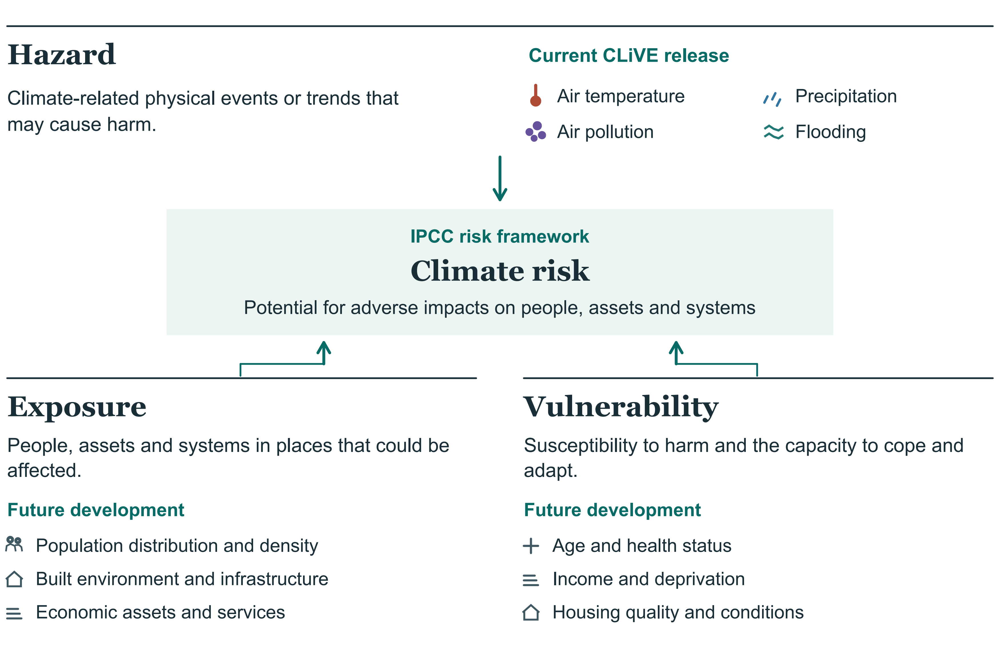
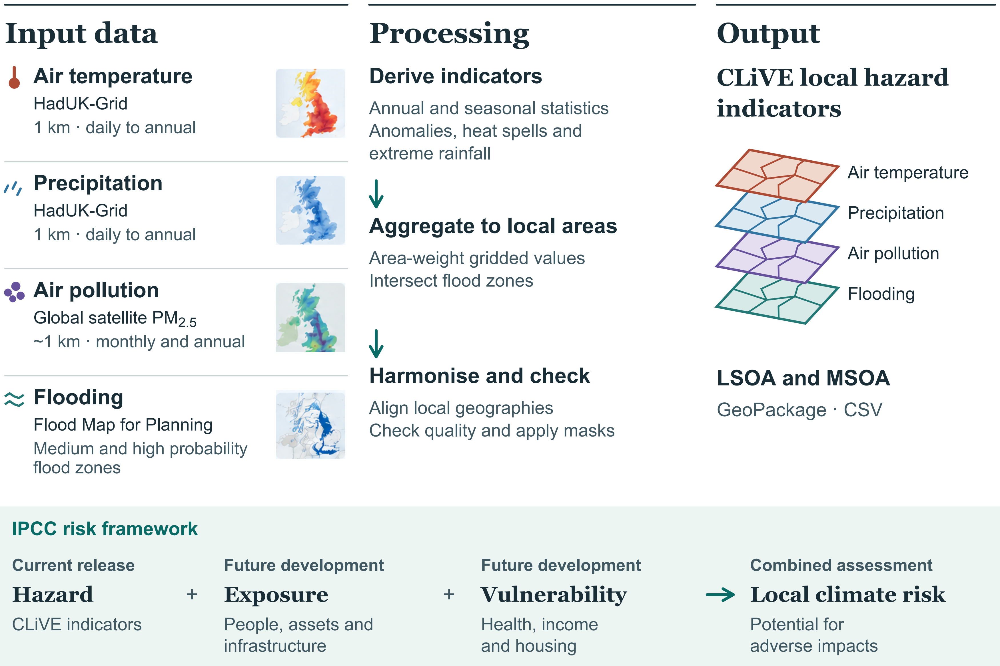
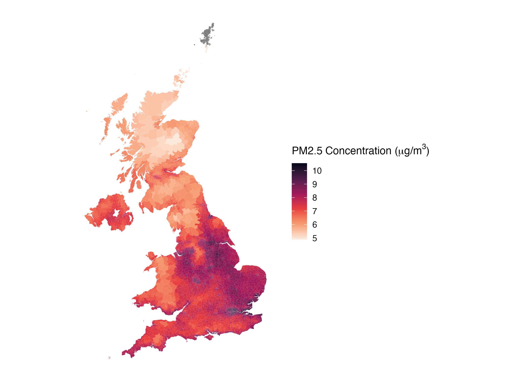

# CLiVE: Climate Local Vulnerability and Exposure

## Introduction - Characterising environmental risk at local scales

Climate change is reshaping the frequency, intensity, and geography of environmental hazards across the UK and the world. Heatwaves are becoming more frequent and severe: the UK Met Office has provisionally declared Summer 2026 the warmest on record, exposing a country that remains poorly equipped to cope with extreme heat [@metoffice2026summer; @ccc2026welladapted]. At the same time, warming-induced atmospheric changes could exacerbate episodes of air pollution, which is associated with the equivalent of 28,000 to 36,000 deaths a year [@phe2018airpollution]. Precipitation patterns are also shifting and becoming more intense. Winters are wetter and downpours more frequent. For each degree of regional temperature rise, extreme rainfall intensifies by 5-15% [@kendon2023variability]. In England and Wales, October 2023--March 2024 was recorded as the wettest half-year winter in more than 250 years [@kendon2025soukc], part of a longer-term trend that is driving up flood risk. A estimated of 6.3 million English properties are located in flood risk areas. This is a figure projected to reach one in four by mid-century [@ea2024nafra].\
Climate-related hazards impact places or populations in different ways. Their impacts are shaped by the distribution of people and infrastructure, and by social and economic inequalities that influence individuals' capacity to prepare for, cope with, and recover from adverse events [@cutter2012social]. Measuring hazards at this level of granularity is therefore essential. Yet the central obstacle is increasingly the use of available data. While relevant data exist, they are often beyond the reach of the social scientists, policymakers and practitioners who most need them. Climate and environmental datasets are typically distributed in specialised formats that require technical expertise to process. Where datasets are accessible, they are frequently too coarse to capture subnational variation, updated too infrequently to track change, or too narrow in scope, overlooking dimensions such as population exposure and vulnerability. The result is a persistent gap between the data that exist and the data that local governments, public health agencies, and researchers can actually act on to identify priority areas, target interventions, and track progress over time.\
*CLiVE* (Climate Local Vulnerability and Exposure) aims to provide indicators to characterise environmental risk at local scales for the whole of the UK. We focus, to date, on environmental dimensions particularly relevant in the UK context, including temperature, precipitation, air pollution and flooding. In the UK's official climate risk assessment, flooding, heat, and water shortages are listed among the priority risks to people and the built environment [@hmg2022ccra3; @ccc2026welladapted]. Air pollution is also included as it is regarded as the "largest environmental risk to public health in the UK\" by the government [@commonslibrary2026airquality]. Together these four environmental dimensions form the basis for the hazard component of the IPCC risk framework [@klein2014climate], providing a foundation onto which exposure and vulnerability can subsequently be layered.

## Quantifying local risk: a conceptual framework

*CLiVE* provides a spatially granular, and policy-relevant suite of indicators to quantify environmental risk across the UK. The product is structured around the risk conceptualisation of the Intergovernmental Panel on Climate Change (IPCC)  [@klein2014climate], which defines risk as arising from the interaction of three components: hazard, exposure, and vulnerability, as illustrated in @fig-ipcc_clive.

-   **Hazard**: the potential occurrence of a natural or human-induced physical event or trend that may cause adverse impacts, including climate-related hazards such as extreme heat and flooding.

-   **Exposure**: the presence of people, livelihoods, infrastructure, ecosystems or other economic, social or cultural assets in places and settings that could be adversely affected.

-   **Vulnerability**: the propensity or predisposition to be adversely affected, encompassing sensitivity or susceptibility to harm as well as the capacity to cope and adapt.

{#fig-ipcc_clive width="100%" fig-alt="Diagram showing the interaction of hazard, exposure and vulnerability and the four current CLiVE hazard domains"}

Within this framework, *CLiVE* has so far focused on the hazard component., It measures the physical environmental events and trends, including heat, rainfall, air pollution and flooding, that can cause harm. This hazard layer forms a foundation. It can be combined with data on exposure (who and what is in harm's way) and vulnerability (who is least able to cope or recover), to build a fuller picture of risk.\
Importantly, these components are not static or independent. Climate-related risk varies across space and over time as hazards change and as patterns of population, infrastructure and social vulnerability evolve. A high level of hazard does not, therefore, translate into the same level of risk everywhere. Two places facing identical flooding or heat exposure can experience very different impacts, depending on who lives there, what is built there, and how well-equipped that population and infrastructure are to cope. This dynamic is central to *CLiVE*'s longer-term vision. Rather than treating hazard alone as a proxy for climate risk, *CLiVE* is designed so that hazard indicators can progressively be linked with comparable, co-located indicators of exposure and vulnerability, moving from a hazard-only picture towards a fully integrated understanding of local climate risk.\
In its initial release, CLiVE focuses on developing and harmonising indicators of climate-related environmental hazards. These combine Earth Observation, meteorological observations and authoritative environmental datasets, depending on the most appropriate source for each phenomenon. Initial components include indicators relating to air temperature, precipitation, air pollution and flooding. CLiVE processes these datasets into harmonized, ready-to-use indicators at standard small-area statistical geographies, including LSOAs and MSOAs, reducing the need for specialist Geographic Information System (GIS) expertise and additional spatial processing. The resulting indicators are made available in accessible formats, including CSV and GeoPackage (GPKG), allowing users to link environmental information with other social, health and economic datasets. Future development will extend this framework by linking these environmental indicators with population exposure and social vulnerability variables.

## Overview of the CLiVE methodology

This section sets out which indicators *CLiVE* measures, why they are relevant to the UK and how they are produced. The following section then describes each set of indicators in detail.

### Overview of CLiVE indicators

We present all current *CLiVE* indicators available in the latest data release. @tbl-clive-variables lists each indicator by hazard domain, describing what it measures, its unit or scale and the corresponding fields in the released datasets.

The four hazard domains reflect the priority climate and environmental risks identified for the UK. Flooding and heat are among the priority risks to people and the built environment in the UK's official climate risk assessment, and air pollution is regarded as the largest environmental risk to public health [@hmg2022ccra3; @ccc2026welladapted; @commonslibrary2026airquality]. Within each domain, the indicators distinguish typical conditions, long-run change and extremes. Averages describe the conditions a neighbourhood usually experiences, anomalies against the 1884--1900 baseline capture departures from historical norms, and counts of hot days, cold spells or extreme rainfall days capture short-lived events. Where UK agencies define operational thresholds, *CLiVE* adopts these definitions. Heat and cold indicators follow the Met Office heatwave definition and UKHSA alert criteria [@metoffice_heatwave; @ukhsa_wha_userguide], and flooding indicators use the flood zones of the national Flood Map for Planning [@ea_floodmap_planning; @nrw_floodmap_planning]. All indicators are delivered for standard UK statistical geographies, so they can be linked directly to census, health and administrative data.

| Domain | Indicator | What it measures | Unit or scale | Dataset field(s) |
|---|---|---|---|---|
| Air temperature | Annual and seasonal mean | Average air temperature over the year or season. | °C | `annual_mean_tmp`, `winter_mean_tmp`, `spring_mean_tmp`, `summer_mean_tmp`, `autumn_mean_tmp` |
| Air temperature | Mean daily highs and lows | Average daily high and low over the year, average daily high in summer, and average daily low in winter. | °C | `annual_max_tmp`, `annual_min_tmp`, `summer_max_tmp`, `winter_min_tmp` |
| Air temperature | Seasonal variability | How much the four seasonal mean temperatures differ within a year. | Standard deviation, °C | `temporal_sd_tmp` |
| Air temperature | Annual anomaly | Departure from the historical annual mean. | °C or baseline standard deviations | `tmp_anomaly_absolute`, `tmp_anomaly_relative` |
| Air temperature | Hot days | Summer days with a daily high of at least 30°C. | Days | `extreme_hot_days_mean` |
| Air temperature | Hot spells | Overlapping three-day summer windows with a daily high of at least 25°C on all three days. | Windows | `hot_spell_3day_mean` |
| Air temperature | Cold days | Winter days with a daily low of 0°C or below. | Days | `extreme_cold_days_mean` |
| Air temperature | Cold spells | Overlapping three-day winter windows with a daily low of 2°C or below on all three days. | Windows | `cold_spell_3day_mean` |
| Precipitation | Annual and seasonal rainfall | Accumulated rainfall over the year or season, averaged across the area. | mm | `rainfall_annual_mm`, `winter_rainfall`, `spring_rainfall`, `summer_rainfall`, `autumn_rainfall` |
| Precipitation | Annual anomaly | Departure from the historical annual rainfall mean. | mm or baseline standard deviations | `annual_anomaly_abs`, `annual_anomaly_std` |
| Precipitation | Extreme rainfall days | Days when grid-cell rainfall is at least four standard deviations above its historical daily mean. | Days | `extreme_days_4sd` |
| Air pollution | Annual and monthly PM₂.₅ | Mean estimated fine-particle concentration over the year or calendar month. | µg/m³ | `pm2.5_mean`; monthly fields `pm2.5_mean_01` to `pm2.5_mean_12` |
| Flooding | Neighbourhood and mapped flood-zone area | Total neighbourhood area, area in Zones 2 and 3 combined, and area in Zone 3 alone. | km² | `total_area_km2`, `flooded_area_km2_FZ2and3`, `flooded_area_km2_FZ3` |
| Flooding | Mapped flood-zone presence | Whether any part of the neighbourhood intersects mapped Zones 2 or 3. | 1 = yes, 0 = no | `dummy_flooded` |
| Flooding | Share in mapped flood zones | Proportion of the neighbourhood in mapped Zones 2 or 3. This does not show whether flooding occurred. | Proportion (0--1) | `ratio_flooded_total` |

: Current CLiVE indicators {#tbl-clive-variables tbl-colwidths="[15,18,29,12,26]"}

### Processing workflow

We describe the preparation of the CLiVE data products in @fig-clive-workflow. It is organised into three main elements: input data, processing steps and output. For air temperature, precipitation, air pollution and flooding risk, we describe key information, including the input data source, as well as spatial and temporal resolution. We then describe the implemented processing steps, which cover pixel-level indicator calculation, spatial intersections and area-weighted aggregations. The datasets are available in an open and easily accessible output format, capturing harmonised local hazard indicators at different regional aggregation levels.

Although gridded sources such as HadUK-Grid provide high-resolution raster data, analysis in their native pixel form is computationally expensive and poorly aligned with social science needs, where climate indicators must typically be associated with administrative geographies rather than individual cells. We therefore convert the pixel-level rasters into lightweight, geometry-based outputs early in the processing pipeline: each indicator is first calculated at the pixel level, then spatially intersected with LSOA, MSOA and LAD boundaries, and aggregated to each area using an area-weighted mean. Flooding indicators follow the same logic, starting from flood-zone polygons rather than pixels. The resulting datasets are indexed by standard ONS area codes (or equivalent), so they can be joined directly to other administrative, survey or census data, either spatially, as a shapefile or GeoJSON, or in tabular form, as a CSV or Excel file, without any further geoprocessing.

{#fig-clive-workflow width="100%" fig-alt="Workflow from environmental inputs through processing to harmonised local hazard indicators"}

## Indicators by hazard domain

<!-- Francisco Rowe, Word comment anchored to the heading above:
We should make  this section to be more practical / interactive, showing some code. Particularly I would use this to illustrate how to CLiVE, read a hazard domain and show its content (i.e. columns) and then map it.
-->

This section describes the four environmental hazards covered in the current *CLiVE* release: air temperature, precipitation, air pollution, and flooding. For each domain, we describe the source data, the indicators we derive and how they are computed, and the spatial patterns they reveal. All indicators are harmonised to standard administrative geographies (LSOA, MSOA, and LAD) so they can be linked directly to other social, health and economic data.

The subsections below build on @tbl-clive-variables, providing more detail on how each individual indicator is computed.

### Air temperature

#### Source data

Air temperature indicators are derived from the HadUK-Grid Gridded Climate Observations dataset, produced by the Met Office Hadley Centre for Climate Science and Services [@metoffice2018haduk; @hollis2019haduk]. HadUK-Grid provides daily and monthly climate observations, interpolated from meteorological stations, at a 1 km by 1 km grid resolution across the UK. The Met Office aggregates the station observations temporally and interpolates them onto the grid before providing the data at daily, monthly, seasonal and yearly aggregations. We use the latest available release (v1.3.1.ceda, published 2025), which covers the period 1836--2024, and draw the most recent ten years, from 2015 to 2024. For daily maximum air temperature, the observation period runs from 9 am UTC on one day to 9 am UTC on the following day [@metoffice_hadukgrid_datasets], and daily values are aggregated to the month, season or year using simple averaging. We selected this dataset as it provides quality-controlled observations at a 1 km spatial resolution for the entire UK over a long period of time, allowing us to detect recent spatial patterns, long-run trends and extreme events.

#### Indicators

**Annual and seasonal mean temperature**. Average air temperature over the year and in each of the four meteorological seasons, capturing the typical thermal conditions of a neighbourhood.

**Mean daily highs and lows**. Average daily maximum and minimum temperature over the year, together with the average daily high in summer and the average daily low in winter, capturing typical daytime heat and night-time cold.

**Seasonal variability**. Standard deviation of the four seasonal mean temperatures, computed at the pixel level before aggregation, capturing how sharply temperature changes across the seasons.

**Annual temperature anomaly**. Departure of the annual mean temperature from its historical baseline, capturing long-run warming relative to historical conditions. For each pixel, we calculate the deviation of temperature from its mean over 1884--1900, the earliest available period in the record, giving an absolute anomaly in degrees Celsius. This follows climate assessment work that uses the earliest observation period to calculate historical anomalies [@ipcc2018sr15]. The relative anomaly divides the absolute anomaly by the historical standard deviation over the same baseline period and is measured in standard deviations.

**Hot days and hot spells**. Counts of summer days with a daily maximum of 30°C or more, and of overlapping three-day windows in which the daily maximum reaches at least 25°C on all three days, extracted from daily maximum temperature for June to August. The hot spell definition follows the Met Office, which defines a heatwave as at least three consecutive days above a threshold. While that threshold varies regionally between 25°C and 28°C, we adopt a uniform value of 25°C for the whole of the UK [@metoffice_heatwave]. The single-day threshold follows the UK Health Security Agency (UKHSA) criteria, under which heat alerts are often issued at temperatures of 30°C or higher, signifying risk to human health [@ukhsa_wha_userguide].

**Cold days and cold spells**. Counts of winter days with a daily minimum of 0°C or below, and of overlapping three-day windows with a daily minimum of 2°C or below on all three days, extracted from daily minimum temperature for December to February. These thresholds follow UKHSA guidance on triggering cold-health alerts, where multiple days at 2°C or less, or single days at 0°C, are commonly applied for medium- and high-impact alerts [@ukhsa_wha_userguide].

#### Spatial patterns

@fig-cloud shows the mean daily maximum temperature over summer 2023 across MSOAs in the UK, highlighting emerging spatial patterns of heat exposure. The indicator averages daily maximum temperatures from June to August, providing a measure of sustained daytime heat exposure that reflects how warm a neighbourhood typically becomes on an average summer afternoon. Temperatures ranged from less than 15°C to 25°C, showing a clear north--south divide. Scotland and northern England remained considerably cooler, while southern England, especially London, experienced the highest summer maxima. Other major cities, including Manchester and Bristol, also emerged as hotspots, underscoring the growing heat burden in densely populated urban areas.

.](images/clive-chp/max_tmp_msoa_2023.png){#fig-cloud width="100%" fig-alt="Map of mean daily maximum summer air temperature by area"}

### Precipitation

#### Source data

Precipitation indicators are derived from the same HadUK-Grid Gridded Climate Observations (v1.3.1.ceda). As with air temperature, the Met Office aggregates rainfall observations from meteorological stations and interpolates them onto the 1 km grid before providing the data [@metoffice2018haduk]. We draw the most recent ten years (2015--2024) at daily, seasonal and annual aggregations. Daily precipitation is the total accumulation in millimetres from 9 am UTC on one day to 9 am UTC on the following day [@metoffice_hadukgrid_datasets].

#### Indicators

**Annual and seasonal rainfall**. Accumulated rainfall over the year and in each of the four meteorological seasons, averaged across the area, capturing how wet a neighbourhood typically is.

**Annual precipitation anomaly**. Departure of annual rainfall from the 1884--1900 baseline, the earliest available period in the record for annual precipitation, capturing long-run change relative to historical conditions [@ipcc2018sr15]. As with temperature, the anomaly is expressed both as an absolute anomaly in millimetres and as a relative anomaly in standard deviations.

**Extreme rainfall days**. Number of days on which daily rainfall exceeds the historical daily mean by four standard deviations or more. Extreme rainfall requires a different approach from temperature. For temperature, the Met Office and the UKHSA provide standard absolute thresholds; for precipitation, no equivalent agreed threshold exists, as the amount of rainfall maps less consistently onto impact. Some studies apply absolute daily thresholds for the UK, such as the 50 mm definition in @cotterill2021increase, whereas others emphasise impact; for example, the Met Office has operated an impact-based warning service since 2011 [@metoffice_warnings]. Because these impacts vary spatially, we adopt a relative threshold that measures extreme events against each location's long-run rainfall. Daily records begin only in 1891, so this indicator uses a 1891--1900 baseline. Detecting these events is computationally demanding, as it requires daily rasters at the pixel level across a long period rather than the pre-aggregated annual or seasonal grids used for the other indicators. By pre-computing this indicator, we spare users the daily, pixel-level processing that is otherwise a substantial barrier to measuring local rainfall extremes.

#### Spatial patterns

@fig-precip shows total annual precipitation across MSOAs in 2023, measured as the total accumulated rainfall over the year. The map highlights a stark divide between the wet north-west and the drier south-east. The areas receiving the highest rainfall include the western Scottish Highlands, the Lake District and Eryri National Park in Wales. By contrast, the south-east of England records the lowest annual rainfall in the country.

.](images/clive-chp/annual_precip_msoa_2023.png){#fig-precip width="100%" fig-alt="Map of total annual rainfall by area"}

### Air pollution

#### Source data

Air pollution is measured by the concentration of fine particulate matter of 2.5 micrometres or less (PM2.5, µg/m³) in the air. Several sources measure PM2.5 in the UK, but we select satellite data because they provide consistent coverage across the whole country. Ground monitors offer direct measurements but are sparse: the Automatic Urban and Rural Network comprises 213 stations, alongside other locally managed sites [@defra_aurn; @defra_local_monitoring], leaving spatial coverage uneven across the UK. Defra's national Pollution Climate Model (PCM) provides modelled estimates at 1 km resolution, but only annually and with the built environment already incorporated [@defra_wms_services]. Satellite data instead allow us to measure mean PM2.5 concentrations more frequently and consistently across the entire UK.

The underlying source data are the global PM2.5 product (V6.GL.02.04) at 0.01° x 0.01° (approximately 1 km) spatial resolution, published by @shen2024enhancing. Because satellites do not measure particulate matter concentrations directly, concentrations are derived from Aerosol Optical Depth observed by instruments such as MODIS and VIIRS, combined with GEOS-Chem chemical transport simulations, deep learning and calibration to ground monitors [@shen2024enhancing]. The product is already preprocessed and available at monthly and annual resolutions. It has two limitations: the estimates come from a global model rather than one specific to the UK, and the Shetland Islands fall outside its spatial coverage.

#### Indicators

**Annual and monthly PM2.5**. Mean estimated concentration of fine particulate matter in µg/m³ over the year and in each calendar month, capturing long-term and seasonal exposure to air pollution. The gridded estimates are aggregated to MSOAs and LADs using an area-weighted mean.

#### Spatial patterns

@fig-pm25 shows the mean annual PM2.5 concentration across MSOAs in 2023. The highest concentrations are in England, concentrated in urban centres including London, Birmingham and Manchester.

{#fig-pm25 width="100%" fig-alt="Map of mean annual PM2.5 concentration by area"}

### Flooding

#### Source data

The *CLiVE* flooding indicators are based on the national Flood Map for Planning products published by the Environment Agency (EA) for England and Natural Resources Wales (NRW) for Wales. These source datasets provide geospatial flood-zone layers representing areas associated with different annual probabilities of flooding from rivers and the sea [@ea_floodmap_planning; @nrw_floodmap_planning]. *CLiVE* does not independently model these flood probabilities; instead, it uses the authoritative flood-zone layers as input and transforms them into harmonised neighbourhood-level indicators. For England, the current release covers 2012 to 2025, excluding 2024; for Wales, it covers 2021 to 2025. In both nations, we focus on Flood Zones 2 and 3.

The definitions of Flood Zones 2 and 3 used for England and Wales are closely aligned, allowing the two national sources to be processed within a common harmonisation framework. Flood Zone 2 represents land with a medium probability of flooding. For river flooding, this corresponds to an annual probability between 0.1% and 1% (between a 1-in-1,000 and 1-in-100 annual chance), while for flooding from the sea it corresponds to an annual probability between 0.1% and 0.5% (between a 1-in-1,000 and 1-in-200 annual chance). Flood Zone 3 represents land with a higher probability of flooding, corresponding to an annual probability of 1% or greater (1-in-100 or greater annual chance) for river flooding, or 0.5% or greater (1-in-200 or greater annual chance) for flooding from the sea [@ea_floodmap_planning; @nrw_floodmap_planning].

#### Indicators

For each year, the flood-zone geometries are spatially intersected with LSOA and MSOA boundaries. Overlapping flood-zone polygons are dissolved before area calculation to avoid double-counting, and the intersected areas are aggregated by geographic area code into annual indicators at both LSOA and MSOA levels. The same workflow and indicators are applied to England and Wales, ensuring methodological consistency and removing the need for end users to undertake repeated spatial overlay and aggregation themselves.

**Neighbourhood and mapped flood-zone area**. Total area of the neighbourhood and the area intersecting Flood Zones 2 and 3 combined and Flood Zone 3 alone, in km², capturing the absolute extent of mapped flood hazard.

**Mapped flood-zone presence**. Binary indicator of whether any part of the neighbourhood intersects mapped Flood Zones 2 or 3 (1 = yes, 0 = no), identifying neighbourhoods with any mapped flood hazard.

**Share in mapped flood zones**. Proportion of the total neighbourhood area within mapped Flood Zones 2 and 3, capturing the relative extent of mapped flood hazard.

#### Spatial patterns

@fig-flood shows the proportion of each LSOA area that falls within mapped Flood Zones 2 and 3 in 2025, for England (panel a) and Wales (panel b).

{#fig-flood width="100%" fig-alt="Two maps of the share of local area in mapped flood zones, England left and Wales right"}

#### Limitations

Although the *CLiVE* flooding indicators improve the accessibility and usability of flood-related information, several limitations should be considered. The underlying Flood Map for Planning datasets represent modelled flood hazard rather than observed flooding events. Consequently, the annual indicators should not be interpreted as records of flooding occurring in a particular year, but as measures of the geographic extent of mapped flood zones based on the available source data. Differences in national modelling approaches, source data and update schedules may also affect comparisons between England and Wales and across years. Furthermore, the indicators describe the proportion of neighbourhood land area within mapped flood zones, but do not directly measure the number of people or assets exposed, their vulnerability, or the actual impacts of flooding. These additional dimensions can be incorporated by linking the *CLiVE* indicators with complementary demographic, socioeconomic, infrastructure and health datasets, supporting a more comprehensive assessment of local climate risk.
