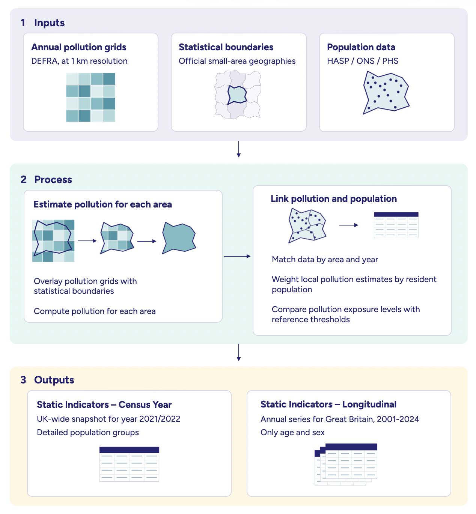

# EXHALE: Exposure to Hazards using Activity, Location and Environment --- Static Air Pollution Exposure Indicators {#sec-exhale-static}


## Motivation and context

### Why EXHALE?

Understanding spatial variation in the prevalence of environmental hazards can help us identify areas where a hazard may pose a greater risk. Yet, understanding risk also requires information about who is exposed. **EXHALE, which stands for *Exposure to Hazards using Activity, Location and Environment***, brings together environmental hazard data and population information with the aim of producing indicators of exposure to environmental hazards across the UK. It draws on expertise in geographic data science through a collaboration between the University of Liverpool, Imago, the University of Leeds and the Healthy and Sustainable Places Data Service (HASP).

Three challenges motivate EXHALE. First, data about environmental hazards is commonly provided in geographies such as grids, that do not match the geographies at which population and administrative data are usually provided. Linking these sources is necessary to identify which population groups live in areas with higher hazard exposure. Second, examining changes in residential exposure requires accounting for changes in both the prevalence of environmental hazards and population over time. Third, residential location captures only part of exposure because people move between places during their daily activities. Therefore, in developing indicators of population exposure to environmental hazards, EXHALE recognises that people might be exposed to hazards where they live, but also where they play, study or work, in other words, in the places they visit in their everyday lives [@mobility25exposure].

To account for the three identified challenges, EXHALE collection comprises three types of data products for exposure to environmental hazards: *Static Indicators -- Census Year*, *Static Indicators -- Longitudinal* and *Dynamic Indicators*. Static indicators use population data available at detailed geographical scales, allowing potential exposure to be examined across different population groups. However, they do not capture exposure outside the residential area. Dynamic indicators account for daily mobility and can therefore represent a wider range of locations where exposure may occur. Their construction requires additional mobility data, which can be harder to obtain and may contain less information about individual characteristics.

This chapter presents the two static products, which describe potential exposure based on residential location. The dynamic product additionally considers people’s daily mobility patterns. EXHALE’s methodological framework can extend to multiple types of environmental hazards. Its current data products focus on air pollution exposure.

### Why air pollution?

Globally, air pollution is the largest environmental health risk causing loss of healthy years of life and premature death [@RCP25]. In 2021, there were approximately 8.1 million preventable deaths linked to air pollution worldwide [@RCP25]. In the UK, the government estimates that the mortality burden of air pollution for 2019 ranged between 29,000 and 43,000 deaths, and cost more than £27 billion [@RCP25].

Yet, exposure to air pollution is unevenly distributed across places and population groups. This is the result of two patterns. First, the sources and concentrations of pollutants vary geographically, reflecting differences in transport, industry, domestic heating, agriculture and other activities [@RCP25]. Broad distinctions between urban and rural areas can conceal substantial variation within them. Understanding exposure therefore requires examining patterns at finer geographical scales, including differences between neighbourhoods within the same city. Second, population groups differ in both their exposure and their vulnerability to air pollution. Where people live and spend their time can lead to some groups being systematically more exposed than others [@differentials-pollutant25]. The consequences of that exposure also depend on factors such as age, existing health conditions and socioeconomic circumstances [@RCP25]. Understanding these inequalities requires identifying where higher pollution levels coincide with populations that may be more vulnerable to their effects.

## The *Static Indicators*

### What the indicators measure {#sec-exhale-indicator-measures}

EXHALE contains two products for ***Static Air Pollution Exposure Indicators***, hereafter *Static Indicators*. These are the ***Static Indicators -- Census Year*** and ***Static Indicators -- Longitudinal***. Both describe potential exposure based on residential location. Here, *static* refers to where exposure is estimated, i.e. residential areas, rather than to pollution levels being constant over time. EXHALE also has a separate data product for *Dynamic Air Pollution Exposure Indicators*. The *Dynamic Indicators*, in addition to information relating to people's residential areas, also consider everyday mobility patterns. The workflow for dynamic indicators is described in a forthcoming chapter. EXHALE's *Static Indicators* are available in the [Imago data catalogue](https://data.imago.ac.uk/) and [HASP data catalogue](https://data.hasp.ac.uk/).


The *Static Indicators* are available at two levels of statistical geography, a lower and an upper level. These levels are nested, i.e. each lower-level area lies within a single upper-level area and each upper-level area is made up of a group of lower-level areas. These geographies serve similar purposes for reporting small-area statistics across the UK, although their names, population sizes and geographic extents differ between countries. For each UK country, these lower and upper levels correspond to the following official geographies:

| Country | Lower geographies | Upper geographies | Census year |
|:------------------|:------------------|:------------------|:------------------|
| England and Wales | Lower-layer Super Output Areas (LSOAs) | Middle-layer Super Output Areas (MSOAs) | 2021 |
| Scotland | Data Zones (DZs) | Intermediate Zones (IZs) | 2022 |
| Northern Ireland | Data Zones (DZs) | Super Data Zones (SDZs) | 2021 |

: Statistical geographies and census reference years used in the census-year product. {#tbl-exhale-census-geographies}


@tbl-exhale-indicator-interpretation summarises what each indicator measures, its unit or scale, the corresponding dataset fields and where it is available.

| Indicator | What it measures | Unit or scale | Dataset field(s) | Availability |
|:---|:---|:---|:---|:---|
| **Area-weighted mean concentration** | Annual mean modelled concentration across the area, weighting intersecting 1 km grid cells by their share of its surface. | µg/m³ | `area_weighted_mean_<pollutant>` | Five pollutants (not ozone); both products and geography levels. |
| **Area-weighted ozone exceedance days** | Area-weighted mean number of days on which the daily maximum eight-hour mean ozone concentration exceeds 120 µg/m³. Can be fractional. | Days | `area_weighted_mean_O3` | Ozone only; both products and geography levels. |
| **Population-weighted exposure (PWE)** | Mean concentration across component areas, weighted by their resident populations. | µg/m³ | `PWE_to_<pollutant>` | Not calculated for ozone. Lower level in England and Wales only; upper level in all countries covered. |
| **Threshold flag** | Whether the area-weighted value exceeds the reference threshold. For ozone, whether the mean exceeds one exceedance day. | Yes / No | Varies by pollutant; see @sec-exhale-access. | All pollutants; both products and geography levels. |
| **Quantile rank** | Relative position among areas above the threshold, ranked by pollutant and geography level, and by year in the longitudinal product. | 0 = at or below threshold; 1–4 = lowest to highest quarter | `quantile_rank` | All pollutants; both products and geography levels. |
| **Total population counts** | Resident population, overall and by population group. | Persons | `total_population_count`; `total_<group>` | Both products and levels. Census year: 58 groups across 12 attributes. Longitudinal: nine age and sex groups. |
| **Exposed-population counts** | Residents of smaller areas above the threshold, overall and by population group. | Persons | `exposed_population_count`; `exposed_<group>` | Both products and levels except the lower level in Scotland and Northern Ireland. |

: Static indicators and accompanying population counts: definitions, fields and availability. {#tbl-exhale-indicator-interpretation}


Exposed-population counts by age and sex are available for both *Static Indicator* products. The census-year product additionally includes counts by socioeconomic, household and health characteristics, as summarised in @tbl-exhale-population-attributes.

| Population attribute | *Static Indicators -- Census year* | *Static Indicators -- Longitudinal* |
|:---------------------|:-----------:|:------------:|
| Age | ✓ | ✓ |
| Sex | ✓ | ✓ |
| Ethnic group | ✓ | — |
| Country of birth | ✓ | — |
| Approximated social grade | ✓ | — |
| Economic activity status | ✓ | — |
| Occupation | ✓ | — |
| Industry | ✓ | — |
| Full-time education status | ✓ | — |
| Family type | ✓ | — |
| Legal partnership status | ✓ | — |
| General health | ✓ | — |

: Population attributes available in the two static products. A tick indicates availability and a dash indicates that the attribute is not included. {#tbl-exhale-population-attributes}

All the indicators are available for five of the six pollutants, i.e. benzene, NO~2~, PM~10~, PM~2.5~ and SO~2~, which are represented by annual mean concentrations. Each pollutant has its own reference threshold. For PM~2.5~, PM~10~ and NO~2~, the thresholds are 5, 15 and 10 µg/m³, respectively, corresponding to the annual guideline values in the [2021 WHO global air quality guidelines](https://www.who.int/publications/i/item/9789240034228/). For benzene, EXHALE uses 5 µg/m³, corresponding to the annual limit value established under Directive 2008/50/EC and listed in the [European Commission’s air quality standards](https://environment.ec.europa.eu/topics/air/air-quality/eu-air-quality-standards_en). For SO~2~, EXHALE uses 20 µg/m³, corresponding to the annual objective for protecting vegetation and ecosystems listed in [DEFRA’s national air quality objectives](https://uk-air.defra.gov.uk/assets/documents/Air_Quality_Objectives_Update_20230403.pdf).

The reference thresholds therefore draw on different standards. WHO's 2021 guidelines include no annual guideline value for SO~2~, so EXHALE uses the vegetation and ecosystem objective as a cautious reference.

For ozone, the source grids record the number of days when the daily maximum eight-hour mean exceeds 120 µg/m³. EXHALE combines the grid-cell counts into an area-weighted mean that can take fractional values. Both products report a descriptive flag and quantile ranks for ozone and omit PWE. The flag is 'Yes' when the area-weighted mean exceeds one day and 'No' at one day or less. The one-day cutoff is an EXHALE classification rule. The UK long-term objective assessed in the source modelling concerns the daily maximum eight-hour mean staying at or below 120 µg/m³ throughout the calendar year [@pugsley2024pcm, sec. 9.1.1].

### Geographic and temporal coverage

The geographic coverage of *Static Indicators -- Census year* extends across the whole of the UK. The availability of individual indicators varies by country and geography level as described below. At the lower level, calculating indicators capturing population-weighted exposure and exposed-population counts requires population data for the finer Output Areas (OAs). These indicators are therefore available for England and Wales, but could not be calculated for Scotland and Northern Ireland, because EXHALE's population inputs for these countries are available only at Data Zone level. Area-weighted pollution estimates and threshold-based indicators are available at the lower level in all four countries. At the upper level, all indicators are available across all UK countries, as population data from the constituent lower-level areas support the calculation of population-weighted exposure and exposed population counts. Ozone is an exception where the EXHALE workflow does not calculate population-weighted exposure at either geography level. The remaining ozone indicators are based on the number of days on which a specified concentration threshold was exceeded, rather than annual mean concentrations as for the other pollutants.

The *Static Indicators -- Longitudinal* describe annual pollutant exposure beginning in 2001 for PM~10~ and NO~2~, 2002 for PM~2.5~ and SO~2~, and 2003 for benzene and ozone. All series extend to 2024. These longitudinal indicators are also available at lower and upper geography levels. However, their geographic coverage is limited to Great Britain, i.e. England, Wales and Scotland. Northern Ireland is not included in the consolidated longitudinal outputs due to limited data availability. The outputs use LSOAs and MSOAs in England and Wales, and Data Zones and Intermediate Zones in Scotland for lower and upper level geographies respectively. England and Wales use 2021 Census boundaries, and Scotland uses 2011 Census boundaries. Users should account for this difference when linking or comparing the two products. As in the census-year product, lower-level population-weighted exposure and exposed-population counts are unavailable for Scotland because the required population data below Data Zone level were not available. For ozone, the population-weighted exposure at either geography level is not provided.

**Comparing years.** DEFRA advises caution when comparing annual grids because the modelling methods change over time [@defra-pcm-background]. The annual assessments also update the emissions inventory and projections used in the model [@pugsley2024pcm, sec. 3.2]. In England and Wales, EXHALE uses a lookup to match 2011 and 2021 Output Areas for the 2001--2014 population estimates. It carries counts over for unchanged areas, sums them where areas merged and apportions counts for splits and more complex boundary changes using 2021 Census postcode population shares as weights. Scottish outputs retain 2011 Data Zone boundaries throughout the series. We therefore recommend using the longitudinal indicators to describe broad trends, for example across a city or region, with particular care when interpreting year-to-year changes in individual areas.


### Interpreting the indicators

We recommend users taking into account the following considerations for the interpretation of indicators:

-   Area-weighted concentration and population-weighted exposure have different interpretations. The former describes the environment across a geographical area, based exclusively on the prevalence of the pollutant being measured. The latter gives more influence to smaller areas containing more residents. Their difference can help distinguish the spatial distribution of pollution from its distribution relative to the resident population. Population-weighted measures are generally preferable when the question concerns human exposure. At the lower level, however, the two measures are often very similar, because Output Areas are usually much smaller than the 1 km grid cells and neighbouring Output Areas draw on the same cells.

-   To count the exposed population, the pollutant concentration estimate of a small residential area is assigned to that area's population. Then, populations in areas above the reference threshold are summed. It is an estimate based on residential location rather than a measurement of each person's inhaled pollution. Dividing the count of exposed people belonging to a certain population group by its corresponding total count gives the estimated share of that group classified as exposed, provided the denominator is non-zero and both fields are available.

-   Higher concentration values indicate higher modelled pollution and higher ozone values indicate more exceedance days. Quantile ranks describe relative levels of exposure among areas that are above the threshold. In the longitudinal product, ranks are recalculated each year. Therefore, they describe the relative position of each area within that year and should not be used alone to assess whether pollution levels have increased or decreased over time.

-   In the census-year lower-geography outputs, PWE and exposed-population counts are intentionally unavailable for Scotland and Northern Ireland because EXHALE's population inputs for these countries are available only at Data Zone level. Total population counts are still provided for these areas. An unavailable exposure value means that it was not calculated, not that nobody is exposed, so it should not be replaced by a zero.

-   Cross-country comparisons must account for the different census reference years. The underlying pollution data are modelled on a 1 km × 1 km grid. Estimates for smaller statistical areas are derived from the grid cells they intersect and do not capture variation within individual grid cells.

### Uncertainty and limitations

The indicators inherit the uncertainty of their inputs. The 2022 Pollution Climate Mapping technical report describes calibration against Automatic Urban and Rural Network (AURN) observations and verification against monitoring data, with separate results for background and roadside NO₂ [@pugsley2024pcm, secs. 1.5 and 3.5]. EXHALE uses the 1 km × 1 km background grids. At this resolution, peaks next to busy roads or industrial sites can be missed, leading to lower estimated exposures for nearby residents. This limitation is particularly relevant for NO~2~, whose concentrations fall steeply with distance from roads.

The synthetic population used in the census-year product reproduces published local Census counts, but the combinations of attributes within each area are model estimates. Some attributes are also grouped coarsely. Ethnic group, for example, distinguishes only White and non-White residents, which hides large differences between ethnic groups. Finally, all indicators describe potential exposure at the place of residence. They do not measure the pollution people breathe indoors, at work or while travelling, which the *Dynamic Indicators* partly address.

## Methodology

### Overview

The workflow in @fig-exhale-workflow has three stages: inputs, process and outputs. Annual pollution grids, statistical boundaries and population data provide the inputs. During processing, pollution grids are overlaid with the geographic boundaries of the target areas and pollution levels are estimated for each statistical area. These estimates are matched with population data by area and year to account for where residents live. Pollution estimates are also compared with reference thresholds to classify areas according to the populations living above those thresholds. The results are the census-year and longitudinal data products.

{#fig-exhale-workflow fig-alt="Three-stage workflow. Inputs are annual pollution grids, statistical boundaries and population data. Processing diagrams show a grid intersecting an irregular area, the intersecting pieces and a combined area estimate, followed by linking pollution and population data. Outputs are the UK census-year snapshot and the Great Britain annual series." width="700"}

### Input data {#sec-exhale-input-data}

The construction of the *Static Indicators* relies on three types of input data. First, modelled **background air pollution grids** from the UK Department for Environment, Food & Rural Affairs (DEFRA), available from the [Air Quality Compliance Data Hub](https://compliance-data.defra.gov.uk/). To create the 1 km × 1 km pollution grids, DEFRA combines official data from the [National Atmospheric Emissions Inventory (NAEI)](https://naei.energysecurity.gov.uk/) with atmospheric dispersion and chemical models to simulate how pollutants spread across the UK. The modelling uses observations from the [Automatic Urban and Rural Network (AURN)](https://uk-air.defra.gov.uk/networks/network-info?view=aurn) to calibrate and evaluate model estimates, with procedures that vary by pollutant [@pugsley2024pcm, sec. 1.5].

Second, **Population data**. For the *Static Indicators -- Census Year* product, EXHALE uses synthetic population records and attributes produced by [HASP](https://data.hasp.ac.uk/). The synthetic population data contain demographic, socioeconomic, household and health attributes, and is available at the level of Output Areas (OAs) in England and Wales and to Data Zones (DZs) in Scotland and Northern Ireland. HASP created this synthetic population specifically for EXHALE using the Flexible Modelling Framework [@harland2013fmf]. Individual records were drawn from the 1% public census microdata teaching files supplied by ONS, National Records of Scotland and NISRA. For each small area, combinatorial optimisation repeatedly swapped records into and out of a sample to reproduce published local Census counts as closely as possible. The resulting records represent simulated residents. Their value for EXHALE is that they bring multiple population attributes together in individual-level records for small areas. These records can then be aggregated to describe potential exposure across different population groups.

For the *Static Indicators -- Longitudinal* product, EXHALE uses annual population estimates and associated age and sex breakdowns from the [Office for National Statistics (ONS)](https://www.ons.gov.uk/peoplepopulationandcommunity/populationandmigration/populationestimates) for England and Wales and [Public Health Scotland (PHS)](https://publichealthscotland.scot/resources-and-tools/health-intelligence-and-data-management/national-data-catalogue/national-datasets/search-the-datasets/national-records-of-scotland-nrs-small-area-population-estimates/) for Scotland. For both sources, the population estimates and age and sex breakdowns cover 2001–2024. The England and Wales inputs use 2011 Census OA boundaries for 2001–2014 and 2021 Census OA boundaries for 2015–2024. The earlier estimates are harmonised to the 2021 boundaries during processing. The Scottish inputs use 2011 Census DZ boundaries throughout 2001–2024. These inputs are aggregated to the lower and upper geographies used in the outputs. The richer breakdown by population group is a distinguishing feature of the *Static Indicators -- Census Year* product.

Third, EXHALE uses **official statistical geographies** produced by the Office for National Statistics for England and Wales, the Scottish Government for Scotland, and the Northern Ireland Statistics and Research Agency for Northern Ireland. These boundaries define the areas for which exposure indicators are calculated. The [UK lower-level boundaries](https://data.imago.ac.uk/datasets/lsoa-boundaries-for-the-united-kingdom-2021) (LSOA-equivalent) and [UK upper-level boundaries](https://data.imago.ac.uk/datasets/msoa-boundaries-for-the-united-kingdom-2021) (MSOA-equivalent) are available through the Imago data catalogue. These boundaries allow the pollution grids to be linked to the areas represented in the population data.

### Constructing indicators

Combining modelled pollution concentrations with population data provides a way to examine inequalities in potential residential exposure. For example, @fecht2015airpollution used population-weighted concentrations to investigate differences by socioeconomic circumstances, ethnicity and age across neighbourhoods in England and the Netherlands. At a global scale, previous studies have combined gridded pollution estimates with population data to calculate population-weighted exposure and examine changes over time [@brauer2016exposure; @shaddick2018integration]. EXHALE follows this general approach by linking pollution grids with small-area population information and producing indicators for different population groups.

The construction of *Static Indicators* requires preparing resident totals, counts by population group and pollution data at the required geographical levels. For the *Static Indicators -- Census Year*, population counts are organised into 58 categories (e.g. children aged 0–15, residents aged 65 and over, female residents) across the 12 attributes listed in @tbl-exhale-population-attributes. These categories overlap across attributes, i.e. a resident can, for example, be counted in an age category, a sex category and an occupation category. Totals by population group are provided for both lower and upper level geographies across the UK. However, exposed population counts cannot be calculated at the lower level in Scotland and Northern Ireland because the finer population data at OA-equivalent level required for this calculation was unavailable. For the *Static Indicators -- Longitudinal*, population counts are available for nine categories across two attributes: seven age bands (0–15, 16–24, 25–34, 35–44, 45–54, 55–64 and 65 years and over) and two sex categories (female and male). These counts are prepared for each year in the series and aggregated to the relevant lower and upper geographies in Great Britain.


For the pollution data, the boundaries of the relevant statistical geographies are overlaid with the annual pollution grids for each pollutant, as illustrated in @fig-exhale-workflow. A spatial join identifies the grid cells that intersect each geographical area, and the area of each intersection is then calculated.


**Area-weighted indicator**. To construct these indicators, the pollutant value in each grid cell is multiplied by the proportion of the target geography covered by that cell. For example, if a cell covers 30% of an LSOA's area, its pollutant value receives a weight of 0.3. These contributions are summed across all intersecting cells to produce the area-weighted indicator. Both static products use this calculation, matching each annual pollution grid to the statistical boundaries used in the corresponding product. For a given pollutant, the area-weighted indicator for geographical area $i$ in year $t$ is calculated as:

$$
\overline{C}_{i,t}^{\mathrm{AW}}
= \sum_{j \in J_i} C_{j,t}\,w_{ij},
\qquad
w_{ij} = \frac{A_{ij}}{A_i}
$$ {#eq-exhale-area-weighted}

where $J_i$ is the set of pollution-grid cells intersecting area $i$, $C_{j,t}$ is the pollutant value in grid cell $j$ in year $t$, $A_{ij}$ is the area of overlap between grid cell $j$ and geographical area $i$, and $A_i$ is the total area of geographical area $i$. The weight $w_{ij}$ therefore represents the share of the target area's surface covered by cell $j$. The weights $w_{ij}$ sum to one when grid cells with valid pollutant values fully cover area $i$.

For ozone, the same weighting method is applied, but $C_{j,t}$ represents the number of days when the highest eight-hour average ozone concentration exceeds 120 µg/m³. The result is therefore an area-weighted mean number of exceedance days, which can take fractional values, rather than a concentration in µg/m³.


**Population-weighted exposure (PWE) indicator**. The population-weighted exposure (PWE) indicator adds information about where people live by weighting the pollutant concentration in each smaller area by its share of the population in the target area. For the upper-geography calculation, the area-weighted pollutant concentration estimates for LSOAs are combined with their population counts to calculate PWE for MSOAs in England and Wales. The same approach uses Data Zone estimates and population counts to calculate PWE for Intermediate Zones in Scotland and Super Data Zones in Northern Ireland. Component areas that are more populous therefore contribute more to the final estimate. For the lower-geography calculation in England and Wales, OA concentration estimates and population counts are used to calculate PWE for each LSOA. For Scotland and Northern Ireland, this calculation is not included because EXHALE’s population inputs for these countries are available only at Data Zone level. Mathematically, PWE for geographical area $i$ in year $t$ is calculated as:

$$
\mathrm{PWE}_{i,t}
= \frac{\displaystyle\sum_{k \in K_i} P_{k,t}\,\overline{C}_{k,t}^{\mathrm{AW}}}
       {\displaystyle\sum_{k \in K_i} P_{k,t}}
$$ {#eq-exhale-population-weighted}

where $K_i$ is the set of smaller areas nested within geographical area $i$, $P_{k,t}$ is the resident population of smaller area $k$ in year $t$, and $\overline{C}_{k,t}^{\mathrm{AW}}$ is its area-weighted mean pollutant concentration. The denominator is the total resident population of the target area, obtained by summing the populations of its component areas. For example, a smaller area containing 30% of the population in the target area contributes 30% of the weight to its PWE estimate. The result is expressed in µg/m³. Both static products use this method. Population and concentration estimates are matched to the relevant year. PWE is not calculated for ozone.

In the census-year calculation, PWE can also be biased downwards where a component area has no concentration estimate but its population is retained in the denominator. The extent of this effect is being checked alongside incomplete grid coverage.

**Threshold indicators**. These indicators are derived by comparing the area-weighted indicator for each pollutant with a specific reference threshold value. Areas with estimates strictly greater than the reference value are assigned 1, while those at or below it are assigned 0. The concentration thresholds used in both products are 5 µg/m³ for PM~2.5~, 15 µg/m³ for PM~10~, 10 µg/m³ for NO~2~, 5 µg/m³ for benzene and 20 µg/m³ for SO~2~. For ozone, the comparison is based on the area-weighted mean number of days when the highest eight-hour average concentration exceeds 120 µg/m³. So an area is assigned 1 if this mean is greater than one day and 0 if it is one day or less. Areas with missing estimates for the area-weighted indicator remain unclassified.

**Quantile rank indicators**. For the quantile rank indicators, areas that are above the threshold, are then ordered by their area-weighted pollutant estimates and divided into four groups, ranked from 1 to 4, with rank 1 representing the lowest values among these areas and rank 4 the highest. Areas below the threshold receive rank 0. For ozone, the ranking uses the area-weighted mean number of exceedance days. Ranks are calculated separately for each pollutant and geography level. For the *Static Indicators -- Census Year*, the relevant census-year observations are ranked together, combining 2021 for England, Wales and Northern Ireland with 2022 for Scotland. For the *Static Indicators -- Longitudinal*, ranks are recalculated separately for each year across Great Britain. The observations above the threshold are classified into groups as evenly as possible, so ranks 1–4 contain approximately the same number of areas. Areas with the same values may fall into different ranks. Rank 0 is not part of this grouping into equally sized groups, so it can contain any number of areas.


## Using the *Static Indicators*

### Accessing the data {#sec-exhale-access}

The *Static Indicators* data is openly available for download from the [Imago data catalogue](https://data.imago.ac.uk/) and [HASP data catalogue](https://data.hasp.ac.uk/).


The following example loads a sample of the PM~2.5~ census-year dataset for upper geographies. This sample retains all columns from the original dataset, but only the first three rows. We load it in R and display only some selected columns:

```{r}

pm25 <- read.csv(
  "images/exhale-static/pm25-upper-geographies-first-three-rows.csv",
  check.names = FALSE
)

knitr::kable(
  pm25[c(
    "geog_code", "year", "area_weighted_mean_PM2.5", "PWE_to_PM2.5"
  )],
  digits = 2,
  row.names = FALSE
)
```

Each row represents an upper-level statistical area. Here, `geog_code` identifies the area and `year` records the reference year. The columns `area_weighted_mean_PM2.5` and `PWE_to_PM2.5` contain the area-weighted mean concentration and population-weighted exposure, respectively, both in µg/m³. Other identifier columns include `geog_name`, `geog_type` and `country`.

The dataset also contains `above_WHO_threshold`, with values `Yes` or `No`, and `quantile_rank`, with values 0–4, as described in [What the indicators measure](#sec-exhale-indicator-measures). The columns `total_population_count` and `exposed_population_count` give the resident population and the estimated number living in smaller areas above the reference threshold. Columns beginning with `total_` and `exposed_` also provide counts for individual population groups; for example, `total_age_15_under` and `exposed_age_15_under` refer to children aged 0–15. The dataset's catalogue metadata describe its sources, geographical and temporal coverage, indicators and limitations.


Both products use the same indicator field names where an indicator is available. The concentration and PWE fields follow the patterns `area_weighted_mean_<pollutant>` and `PWE_to_<pollutant>`, and both products use `quantile_rank`. The threshold flag is `above_WHO_threshold` for PM₂.₅, PM₁₀ and NO₂, `above_European_Commission_threshold` for benzene and `above_DEFRA_threshold` for SO₂. For ozone, `area_weighted_mean_O3` records mean exceedance days and `at_least_1_day_exposed_to_O3_above_120_ug` records the flag using the strict greater-than-one rule.

### Illustrative use cases

The *Static Indicators* support questions such as:

-   Which residential areas have higher pollution levels?
-   How do exposure estimates change when we account for where residents live within an area?
-   Which population groups live in places above a specified pollution threshold?

These questions can inform research on environmental inequality and help identify areas for further investigation.

#### Mapping PM~2.5~ in Liverpool, UK

Which neighbourhoods in the Liverpool urban region should be prioritised for action to reduce PM~2.5~ pollution? To explore this question, we examine variation in pollution levels and potential residential exposure across the Liverpool urban region. We define the region using the [Functional Urban Area (FUA) boundaries](https://www.oecd.org/en/data/datasets/oecd-definition-of-cities-and-functional-urban-areas.html) provided by the OECD. Under the joint EU–OECD definition, a FUA comprises a city and its surrounding commuting zone, capturing the wider area connected to the city through everyday journeys to work. The FUA delimitations provide a relevant context for examining urban air pollution exposure, as everyday urban transport connects urban cores to the surrounding areas, and also contributes to urban air pollution. We use the *Static Indicators* to describe variation in residence-based exposure in the functional urban areas corresponding to Liverpool.

The example uses data from the *Static Indicators -- Census Year* product for 2021. For each urban region, we select LSOAs whose population-weighted centroids fall within the corresponding FUA boundary. We then map the available indicators. These are shown in @fig-liverpool-pm25, where panel A shows the area-weighted indicator, panel B shows the population-weighted exposure (PWE) indicator, panel C shows the threshold flag indicator and panel D displays the quantile rank indicator. The maps suggest that neighbourhoods in the central and southern parts of the Liverpool FUA, particularly those east of the Mersey, may be prioritised for action. These areas show higher area-weighted concentrations and population-weighted exposure, and many fall within the highest UK-wide concentration rank. However, almost all neighbourhoods exceed the reference threshold of 5 µg/m³, indicating that reducing PM~2.5~ pollution is relevant across the wider region.

![***Static Air Pollution Exposure Indicators* for the Liverpool Functional Urban Area, 2021.** A) Area-weighted mean PM2.5 concentration; B) population-weighted exposure to PM2.5; C) areas above the annual PM2.5 reference threshold of 5 µg/m³; and D) quantile rank indicator based on UK-wide ranking, where 0 identifies areas at or below the threshold and ranks 1--4 indicate increasing concentrations among areas above it. All indicators are shown at LSOA level. Data is sourced from EXHALE’s Static Indicators -- Census Year product, developed by the University of Liverpool and Imago in collaboration with the University of Leeds and HASP, using DEFRA modelled pollution data and HASP synthetic population data.](images/exhale-static/liverpool-pm25.png){#fig-liverpool-pm25 fig-alt="Map of area-weighted mean PM2.5 across Liverpool functional urban area LSOAs in 2021, showing spatial variation with higher concentrations in parts of the central urban area."}

#### Child exposure to NO~2~ across the UK

A next question could be: are children aged 0–15 more likely to live in areas with high NO~2~ levels? To explore this, we use the UK-wide NO~2~ *Static Indicators -- Census Year* dataset for upper geographies, combining 2021 observations for England, Wales and Northern Ireland with 2022 observations for Scotland. We define high NO~2~ levels as area-weighted annual mean concentrations greater than 10 µg/m³, the reference threshold used by EXHALE.

The exposed-population counts estimate how many residents within each upper geography live in smaller areas above this threshold. In England and Wales, the calculation sums the populations of Output Areas above the threshold into each MSOA. In Scotland and Northern Ireland, it sums the populations of Data Zones above the threshold into each Intermediate Zone and Super Data Zone, respectively.

The analysis involves three steps:

1.  Select all upper geographies across the UK.
2.  Sum the exposed counts for children aged 0–15 and divide by their total population count. Calculate the equivalent share for the population overall.
3.  Compare the two shares.

We obtain the following counts:

| Population group | Residents in areas above the threshold | Total population | Share above the threshold |
|------------------|------------------|------------------|------------------|
| Children aged 0–15 | 6,552,221 | 12,315,084 | 53.20% |
| All residents | 34,058,387 | 66,940,195 | 50.88% |

: Estimated populations living in smaller areas with area-weighted annual mean NO~2~ concentrations above 10 µg/m³ across the UK, using 2021 data for England, Wales and Northern Ireland and 2022 data for Scotland. {#tbl-exhale-child-no2}

Children aged 0–15 were more likely to live in areas above the NO~2~ reference threshold than the population overall. An estimated 53.20% of children lived in smaller areas above the reference threshold, compared with 50.88% of all residents, a difference of 2.32 percentage points. This finding has implications for public health because NO~2~ can irritate the airways and aggravate asthma and children are particularly susceptible to its effects [@epa2026no2; @belanger2013nitrogen]. Yet, it is important to note that the residence-based indicators describe potential environmental exposure, and do not measure individual exposure or indoor exposure.

#### Evolution of exposure to air pollutants in Leeds, 2003–2024

We also explore an application of the longitudinal dataset. How has residential exposure to air pollution changed over time in Leeds, UK? We use the *Static Indicators -- Longitudinal* product for 2003–2024, focusing on the area-weighted indicators for all six pollutants. In this case, we use the lower-geography dataset. The upper-geography dataset could support a similar analysis

We select LSOAs whose 2021 population-weighted centroids fall within the Leeds FUA boundary as defined by [OECD](https://www.oecd.org/en/data/datasets/oecd-definition-of-cities-and-functional-urban-areas.html). This identifies 1,596 LSOAs. For each pollutant and year, we multiply each LSOA’s area-weighted indicator by its polygon area, sum these contributions and divide by the total area of the selected LSOAs. Larger LSOAs therefore contribute more to the regional estimate. The results represent annual mean concentrations in µg/m³ for five pollutants and the mean number of ozone exceedance days per year. The results are displayed in @fig-leeds-longitudinal.

{#fig-leeds-longitudinal fig-alt="Six line charts showing changes in air pollution levels across Leeds FUA from 2003 to 2024. Benzene, nitrogen dioxide, particulate matter and sulfur dioxide concentrations decline overall, while ozone exceedance days fluctuate substantially."}


The results show an overall decline in concentrations between 2003 and 2024, although the trajectories include fluctuations between years. NO~2~ concentrations declined from 17.85 to 5.46 µg/m³, a reduction of approximately 69%. For example, benzene concentrations declined from 0.59 to 0.23 µg/m³, which is a reduction of approximately 61%. The corresponding reductions were 52% for PM~2.5~, 68% for SO~2~ and 36% for PM~10~. Ozone followed a more variable trajectory, with pronounced peaks in several years rather than a consistent decline. Its area-weighted mean number of exceedance days nevertheless fell from 11.82 in 2003 to 0.72 in 2024. These are days on which the daily maximum eight-hour mean ozone concentration exceeded 120 µg/m³.

The observed trends are consistent with air quality statistics published by DEFRA [@defra2026airquality], which report long-term improvements in the analysed pollutants across the UK. Similarly, DEFRA reports substantial yearly variability for ozone. This variability is associated with weather conditions, and complex chemical interactions involving precursor pollutants.
