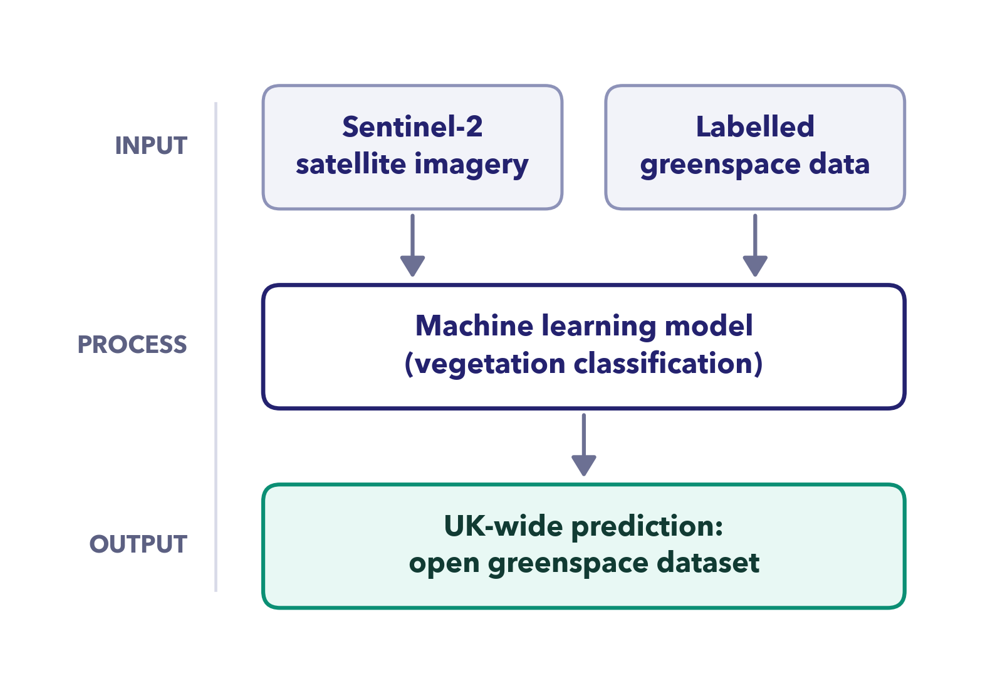

# RGB: Resources in Green and Built environments

::: {.callout-warning icon="false"}
The text in this chapter has also been included in the State of Imagery.
:::

## Introduction

*RGB* (Resources in Green and Built Environments) aims to transform how researchers and policymakers understand, measure and compare green and built environments across the UK. As cities are increasingly exposed to environmental hazards from climate change, the greening of urban areas has become central for climate adaptation and urban resilience [@gill2007adapting]. The presence of nature and the configuration of built environments are critical determinants of health, wellbeing, and sustainability across the UK. Exposure to green environments has been shown to support physical activity, reduce stress, and mitigate the impacts of air pollution and extreme heat [@nguyen2021green; @james2015review; @lafortezza2009benefits]. Understanding how vegetation is distributed across neighbourhoods is therefore important for examining environmental inequalities and informing interventions that support healthier and more sustainable communities.

Satellite imagery provides opportunities to measure vegetation consistently across large geographical areas. However, processing these datasets requires specialist geospatial expertise, substantial computational resources and additional analysis to produce indicators compatible with demographic, socioeconomic and health data. RGB addresses these barriers by transforming Sentinel-2 imagery into accessible, neighbourhood-level environmental indicators. Through its initial product, RGB Green, delivers an open, nationwide greenspace dataset for 2024 for small-area statistical geographies. This enables researchers and policymakers to examine geographical differences in vegetation coverage and integrate environmental information with wider social and economic datasets without undertaking complex satellite image processing.

## What does RGB offer?

The initial release of RGB Green provides a UK-wide classification of vegetated and non-vegetated surfaces for 2024. The classification is derived from Sentinel-2 satellite imagery at a 10 m pixel resolution, providing consistent measurements of vegetation across different geographical contexts, from densely developed urban areas to suburban and rural landscapes.

The resulting pixel-level classifications are aggregated to small area statistical geographies to produce neighbourhood-level indicators of vegetation coverage. These comprise Lower Layer Super Output Areas (LSOAs) in England and Wales, Data Zones in Scotland, and Super Data Zones in Northern Ireland. This geographical structure allows users to compare vegetation coverage between neighbourhoods and integrate RGB with complementary datasets, including Census information, the Index of Multiple Deprivation (IMD), public health statistics, housing data and other environmental datasets. These linkages support research into relationships between neighbourhood environments, population characteristics and wider social, economic and health outcomes.

While the initial release focuses on vegetation coverage, future development of RGB will extend its temporal and thematic coverage. Planned developments include extending the dataset to 2025 and subsequent years, introducing indicators of vegetation configuration and landscape characteristics, and incorporating additional indicators of the built environment across small area statistical geographies. These developments will broaden the range of environmental characteristics that can be examined through RGB and support comparisons across places and over time.

## Research and policy application of RGB

**Health, wellbeing and environmental exposure.** RGB can support research into how neighbourhood environments relate to population health and wellbeing. By examining differences in vegetation coverage across neighbourhoods alongside health indicators, researchers can investigate whether communities with different environmental characteristics experience different health outcomes. This can help explore the potential role of local environments in shaping health inequalities.

**Environmental distribution and inequalities.** RGB Green provides an opportunity to examine how vegetation is distributed across neighbourhoods and whether these patterns vary with socioeconomic conditions. By comparing neighbourhood-level vegetation indicators with measures of deprivation and demographic characteristics, researchers can identify communities with relatively limited vegetation coverage and investigate whether environmental resources are distributed unequally across society. As RGB develops to include further indicators of green and built environments, this analysis can be extended to a broader range of neighbourhood characteristics.

**Planning, policy and environmental change.** RGB can inform urban planning and climate adaptation by helping identify neighbourhoods where vegetation coverage is relatively limited and where greening interventions could be considered alongside other environmental and social priorities. The development of multi-year data will also create opportunities to examine changes in vegetation coverage over time and assess how environmental conditions evolve across neighbourhoods. These insights can support the monitoring of environmental change and inform the evaluation of place-based planning and greening strategies.

## Building RGB Green

The development of RGB Green consists of three main stages: input data preparation, processing and classification, and generation of the final data products. @fig-workflow provides an overview of the workflow.

**Input**

The primary inputs consist of Sentinel-2 satellite imagery and official UK greenspace datasets used to construct reference labels. Sentinel-2 imagery is collected between June and August to capture vegetation during the summer growing season. Images with more than 60% cloud cover are excluded, while cloud and shadow pixels are removed using the Sentinel-2 Scene Classification Layer [@sentinelhub_scl]. The remaining observations are combined to create a cloud-free mosaic. Several spectral indices, including the Normalised Difference Vegetation Index (NDVI) and Normalised Difference Built-up Index (NDBI), are then calculated to help distinguish vegetation from other surfaces. Reference data are obtained from official sources, including OS Greenspace and Natural England datasets, and used to identify locations containing vegetation for model training.

**Processing**

RGB Green uses machine learning to identify vegetated and non-vegetated surfaces across the UK at a 10 m pixel scale. Simpler methods using satellite imagery typically rely on a single measure of greenery, such as NDVI, and apply one fixed threshold to decide what counts as vegetation. However, because the UK spans a wide variety of landscapes, plant types and urban environments, a single threshold rarely works well everywhere. Instead, RGB Green combines multiple signals from the imagery and learns from examples of known greenspaces across the country, enabling it to recognise vegetation reliably across different settings. To check how well it performs, the model is tested on separate areas that were not used during training. For each pixel, the model estimates how likely that location is to contain vegetation. A single cut-off, chosen to give the most accurate results, is then applied consistently across the UK to classify each pixel as either vegetated or non-vegetated.

**Output**

The resulting dataset provides a UK-wide classification of vegetated and non-vegetated surfaces at 10 m spatial resolution for 2024. These pixel-level classifications are aggregated to small area statistical geographies to produce indicators of vegetation coverage. The resulting indicators allow users to compare vegetation across neighbourhoods and combine this information with demographic, socioeconomic, health and other administrative datasets without requiring specialist satellite image processing expertise.

{#fig-workflow width="75%"}

## How to use the data product

The dataset can support several practical applications:

- **Health and environmental inequality:** Linking vegetation indicators with health and deprivation data to investigate whether differences in neighbourhood vegetation coverage are associated with unequal health outcomes across socioeconomic groups.
- **Heat, air quality and climate adaptation:** Combining RGB Green with environmental datasets, such as CLiVE, to identify neighbourhoods where limited vegetation coverage coincides with higher heat exposure or poorer air quality. This can help inform priorities for urban greening and climate adaptation (see the [CLiVE chapter](clive.qmd)).
- **Deprivation, economy and social cohesion:** Linking vegetation indicators with property and socioeconomic data to investigate relationships between neighbourhood vegetation, housing values and neighbourhood change, including green gentrification.

These examples demonstrate how RGB Green can be integrated into existing research and policy workflows. As additional indicators and years become available, the dataset will support more detailed analyses of environmental change and relationships between green and built environments.