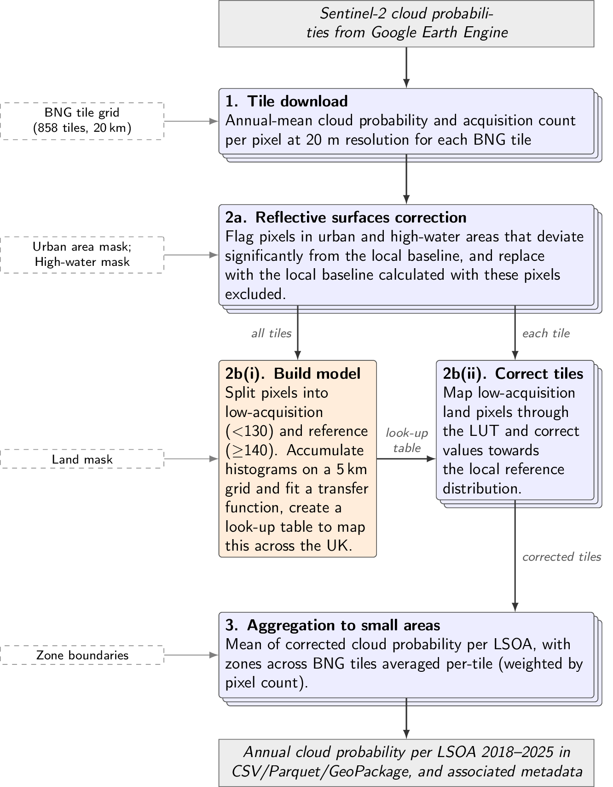
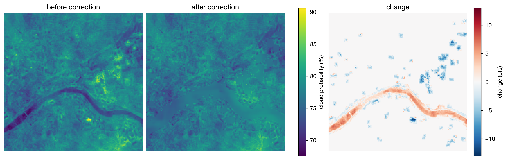
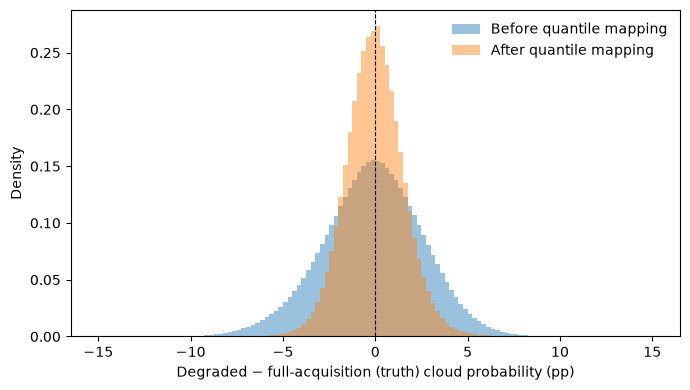
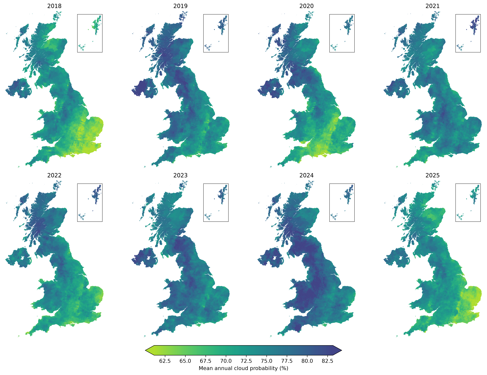

---
aliases:
  - psf.html
bibliography: ../references.bib
format:
  html:
    html-math-method: katex
    code-tools: true
    embed-resources: true
---

# Sunshine from Space

## Introduction

Weather is the stuff of small talk, but measuring it well is anything but small. In the UK in particular, a discussion over whether it was sunny or grey is close to a national pastime. Social scientists have also noticed that sunshine matters for more than small talk. A substantial body of research links it to mood and cognition, to how much people spend in shops, to how much risk investors are willing to take, and to what people will pay for a house [@keller2005warm; @murray2010effect; @hirshleifer2003good; @fleming2018valuing]. Yet when we try to bring sunshine into our analyses, we quickly run into a measurement problem. The data we have are either too coarse, too sparse, or, as we will see, too entangled with the very things we want to study.

This chapter introduces the Sun Probability Framework (SPF), an Imago data product that measures how cloudy (and, by extension, how sunny) every small area[^spf-small-area] of the UK is, year by year, using satellite imagery. As in the rest of this book, we take a perspective that we hope is closer to the frameworks that social scientists and other practitioners who might use SPF have in mind. We will not go through the technicalities of each step in the pipeline; the technical paper does that [==XXXcite_spf_technical_paperXXX==]. Instead, we focus on the _intuition_ behind how a satellite can tell us whether it was sunny, the _choices_ that go into turning millions of images into a single number per small area, and the _relevance_ of the result for social research and policy.

[^spf-small-area]: Data Zones in Scotland and Northern Ireland, Lower layer Super Output Areas (LSOAs) in England and Wales.

We have structured the chapter as follows. @sec-spf_what explains how sunshine is usually measured and how satellites offer a different route, almost by accident. @sec-spf_how walks through how SPF turns raw satellite observations into a yearly picture of cloudiness. @sec-spf_why makes the case for why this should interest you as a social researcher or policy maker. @sec-spf_product introduces the Imago SPF data product and how to use it, along with its caveats. We wrap up with @sec-spf_conclusion.

## How do we measure sunshine? {#sec-spf_what}

### From the ground up

The traditional way to measure sunshine is to put an instrument somewhere and record it. For over a century, weather stations have done exactly this, first with glass spheres that burned a trace onto a card whenever the sun was strong enough, and today with electronic sensors. A station gives you an excellent, continuous record of how sunny it was _at that spot_ over time. The problem is that stations are few and far between. The UK has a few hundred stations that record sunshine, and they are not spread evenly: there are many more in some regions than in others, and remote uplands are poorly covered [@perry2005generation; @hollis2019haduk].

To get from a handful of points to a full map, scientists _interpolate_[^spf-interpolate]. The best-known UK product of this kind is HadUK-Grid, which provides sunshine (among many other variables) on a 1 km grid [@hollis2019haduk]. To fill in the gaps between stations, the interpolation uses a regression on a set of covariates that are known to correlate with climate, such as elevation, distance to the coast and urban land use. This is a sensible approach for a climatologist. For a social scientist, it hides a catch, which we will come back to in @sec-spf_why: if your sunshine variable is partly predicted from, say, urbanisation, it is no longer independent of the things that come with urbanisation, which are often the very things you are trying to explain.

[^spf-interpolate]: Interpolation means estimating values at places where we have no measurements from the places where we do. In practice, a model is fitted to the point observations across two-dimensional space, often using predictors of the quantity being measured (for sunshine, things like elevation or distance to the coast). That model is then used to predict values over the whole area of interest, typically on a regular grid.

A second family of approaches is _geometric_: given latitude, date and topography, you can work out how much sunshine a place could _possibly_ get. This tells you about the astronomical upper bound (long summer days in Shetland, shaded valleys) and about the sun's declination (how high it climbs in the sky), but nothing about clouds, which largely determine whether that potential is realised. @fleming2018valuing, for example, take this approach.

### One person's trash is another's treasure

Satellites offer a third route, and it comes from an unexpected place. Most satellite imagery used in this book is _optical_: like a very sophisticated camera, it records the sunlight reflected off the Earth's surface. That makes it great for seeing buildings, fields, and rivers, but it has an obvious weakness. When there is a cloud between the satellite and the ground, the satellite sees the cloud, not the ground.

Because of this, almost every workflow that uses optical imagery starts with the same step: find the clouds and throw them away. Over the years, the remote sensing community has developed increasingly sophisticated _cloud masks_, algorithms that go through an image and flag every pixel that is likely to be cloud, so that it can be removed before the "real" analysis begins. One widely used example for the European Space Agency's Sentinel-2 satellites is s2cloudless [@zupanc2017improving], a machine learning classifier that gives every pixel a _probability_ of being cloud, from 0 (certainly clear) to 1 (certainly cloud).

Here is the idea at the heart of SPF. For most users, the cloud mask is a by-product, an annoyance to get past. But if what you are interested in is _how cloudy a place is_, the cloud mask is not a nuisance; it is the data. Every time a satellite passes over a place and the cloud mask says "cloud" or "clear", that is an observation of the sky over that place at a consistent time. Collect enough of them, and you have a measure of cloudiness built entirely from direct observation, with no interpolation from distant stations and no regression on land use.

### What a satellite sees, and when

Before going further, it is worth being precise about what this kind of observation is, and what it is not.

First, it is a _snapshot_. Sentinel-2 satellites are in a sun-synchronous orbit, which means they pass over any given place at roughly the same local time, around 10:30 in the morning. Each observation tells us whether it was cloudy at that moment, not over the whole day. Clouds have daily rhythms of their own (on summer days, for instance, clouds over land often build up during the afternoon) so a morning snapshot is not a perfect stand-in for the whole day [@eastman2014diurnal; @voUrbanEffectsLocal2023].

Second, it is about _cloud_, not _sunshine_ as a station records it. A sunshine recorder measures hours of bright, direct sun; a cloud mask flags whether the view of the ground was blocked. The two are closely related (clear skies are sunny skies) but they are not the same thing. Thin, high cloud, for instance, may be flagged as cloud by the satellite while still letting enough sun through to register at a station. We will see the practical consequence of this in @sec-spf_product.

Third, not every place is observed equally often. The satellites image the Earth in long strips, or _swaths_, and where neighbouring swaths overlap, places are seen more often than elsewhere. Some pixels in the UK are observed many more times a year than others. As any social scientist who has worked with surveys knows, a proportion computed from a small sample is noisier than one computed from a large sample. The same is true here.

## From pixels to a yearly picture {#sec-spf_how}

Given a stack of cloud probabilities for every 20 m pixel in the UK, taken every time a satellite passed over in a given year, how do we arrive at a single, reliable number per pixel? This section goes over the process step-by-step; @fig-spf_pipeline gives an overview.

::: {#fig-spf_pipeline}
{width="600" fig-alt="Flowchart of the SPF pipeline. Sentinel-2 cloud probabilities from Google Earth Engine feed into 1, tile download: annual mean cloud probability and acquisition count per 20 m pixel for each of 858 British National Grid tiles. This feeds 2a, reflective surfaces correction, which uses urban and high-water masks to replace outlying pixels with the local baseline. Results from all tiles feed 2b(i), build model, which uses a land mask to split pixels into low-acquisition (under 130) and reference (140 or more), accumulates histograms on a 5 km grid and produces a look-up table. Each tile then passes through 2b(ii), correct tiles, which maps low-acquisition pixels towards the local reference distribution. Finally, 3, aggregation to small areas, uses zone boundaries to take the mean per area, producing annual cloud probability per area for 2018 to 2025 as CSV, Parquet and GeoPackage files."}

**The SPF pipeline.** Annual cloud probabilities are computed per 20 m pixel on Google Earth Engine (1), corrected for reflective surfaces (2a) and for uneven numbers of observations using quantile mapping (2b), then averaged to small areas (3). Dashed boxes show the auxiliary data used at each stage.
:::

**Step 1: Averaging over the year.** For every pixel, we take all the observations in a year and compute their mean. The result is the average probability that the pixel was under cloud when the satellite passed over it. If you prefer, you can read it roughly as the share of satellite visits on which the sky was cloudy; because s2cloudless gives a probability rather than a simple yes or no, it also carries some information on how cloudy each pixel looked. This is the "raw" SPF. Because Sentinel-2 revisits every few days, a year gives us a large number of observations per pixel, and we also record how many there were, since this is the "sample size" behind each estimate. This step runs on Google Earth Engine, which lets us process years of imagery for the whole country without downloading it first.

**Step 2: Correcting for things that look like clouds but aren't.** Cloud masks work by spotting things that are bright and white from above. Unfortunately, so are some things on the ground: large white roofs, greenhouses, sandy beaches, salt marshes. Left alone, these surfaces show up as suspiciously shaped "cloudy" spots that do not make physical sense: there is no reason a warehouse roof should have more cloud above it than the field next door. The reverse can also happen: water is dark, so rivers and estuaries can look clearer than the land around them. Since, over a year, cloud should be distributed fairly smoothly, we can treat these spots as outliers. We identify them with the help of land cover masks (built-up areas, coastline, tidal water) and pull them back towards the values of their surroundings (@fig-spf_reflective).

::: {#fig-spf_reflective}
{width="700" fig-alt="Three panels over Newcastle upon Tyne, 2024. Left: annual cloud probability before correction, with bright yellow building-shaped patches over industrial and built-up sites and a dark band along the River Tyne. Middle: the same area after correction, where both the bright patches and the dark river have blended into their surroundings. Right: a map of the change, with blue patches where bright surfaces were lowered by up to about 10 points and a red band along the river where values were raised."}

**Correcting for reflective surfaces, Newcastle upon Tyne, 2024.** Annual cloud probability before (left) and after (middle) the Step 2 correction, and the difference (right). Bright roofs and built-up sites look cloudier than their surroundings and are pulled down (blue); the River Tyne, whose water looks darker and so "clearer" than the land around it, is pulled up (red). Everywhere else is left unchanged.
:::

**Step 3: Recalibrating places we saw less often.** Finally, we tackle the uneven number of observations directly. Pixels seen only a few times in a year do not just have noisier averages. Their whole distribution of values tends to be systematically off compared with well-observed pixels nearby. To fix this, we use _quantile mapping_. For each part of the country, we compare the distribution of SPF values among well-observed pixels with that among poorly-observed ones, and adjust the latter so the two distributions line up. A social scientist might think of this as close kin to reweighting a non-representative sample so its distribution matches a benchmark. The correction is estimated on a coarse grid covering the whole UK and smoothed across it, so it changes gradually with location rather than jumping at arbitrary boundaries. To check that this works, we can take well-observed pixels, artificially throw away some of their observations, and see how far the result drifts from the full-data value before and after the correction (@fig-spf_quantile_hist).

::: {#fig-spf_quantile_hist}
{width="600" fig-alt="Overlaid histograms of the error in annual cloud probability, in percentage points, for pixels with artificially reduced observations, compared with their full-acquisition value. Both are centred on zero. Before quantile mapping (blue) the distribution is wide, with errors spreading out to around plus or minus 8 points. After quantile mapping (orange) it is much narrower and taller, with most errors within about plus or minus 3 points."}

**Quantile mapping reduces the error from having fewer observations.** Difference between cloud probability computed from a reduced set of observations and from the full set (the "truth"), in percentage points, before (blue) and after (orange) quantile mapping. Both are centred on zero, but the correction roughly halves the spread.
:::

The output of these three steps is a 20 m resolution raster for each year, covering the whole UK, where each pixel holds the corrected annual probability of cloud. Higher values mean cloudier; lower values mean sunnier. (Yes, the "Sun" Probability Framework goes _up_ when it gets cloudier. We keep the name because it describes what the product is for, but it is worth keeping in mind when you interpret a regression coefficient.)

## Why should social researchers care? {#sec-spf_why}

<!--(1) independence from land-use covariates (the exogeneity argument); (2) resolution + consistency + annual vintages; (3) ready-made for linkage. Then one honest paragraph on limits of weather-as-instrument. -->

Now that we know what SPF is and how it is built, we can ask why it is worth your time. We see three reasons, from the most distinctive to the most practical.

**It is measured, not modelled from the things you study.** Interpolated products like HadUK-Grid fill the gaps between stations partly using urban land use as a predictor. For many purposes this is harmless, even desirable. But suppose you want to study whether sunnier neighbourhoods have higher house prices, or whether sunshine is associated with health outcomes. Urbanisation is tied to house prices, to health, to income, to almost everything social scientists care about. A sunshine measure partly _predicted from_ urbanisation carries some of that in with it, and in a regression this can look like an effect of sunshine when it is really an effect of the city. SPF is built from direct observations of the sky over each place. Our corrections are designed to _remove_ the influence of the ground (that is what Step 2 is for), not to add it in. This makes SPF a cleaner candidate for the jobs social scientists often give weather variables: as a control, as a treatment, or as a source of variation that is plausibly unrelated to the social processes being studied. It preserves _exogeneity_ in a way that interpolated products cannot.

**It is detailed, consistent, and refreshed every year.** At 20 m, SPF is far finer than any station-based product. To be clear, this does not mean cloud varies from street to street: it does not. What it means is that wherever cloud cover _does_ change over short distances, for example across a city that sits between hills and the sea, SPF can pick that up rather than smoothing it away on a 1 km or coarser grid. It also means the reflective-surface correction can work on individual roofs and beaches rather than on whole grid cells. And because every place is measured by the same satellites, with the same method, every year, the result is consistent across the country and over time. That makes it suited to comparing places, and to tracking how a given place changes from one year to the next.

**It speaks the language of social data.** Much like other Imago products, SPF is published already aggregated to the small-area geographies used in official statistics. That means you can join it to Census tables, deprivation indices, health records or administrative data with a single area code, without ever touching a satellite image.

## The Imago SPF data product {#sec-spf_product}

### What you get

The current release, SPF 2.0 [@imago_spf_dataset], covers eight annual vintages, 2018 to 2025. As with other Imago small-area products, we take the 20 m raster and aggregate it to the most commonly used Census geographies in each of the four nations: Data Zones in Scotland and Northern Ireland, and Lower layer Super Output Areas (LSOAs) in England and Wales. For each area, we compute the average SPF of all the pixels that fall within it. Each vintage is a separate GeoPackage (and CSV) file that you can open in any GIS software or read directly in Python or R[^spf1]. Every row is a small area, identified by its official code; ==XXX: describe the columns (SPF value; acquisition count?; area code/name; year)XXX==.

[^spf1]: You can download the data product freely from our catalogue at: [`https://data.imago.ac.uk/datasets?groups=spf`](https://data.imago.ac.uk/datasets?groups=spf)

@fig-spf_uk_2018_2025 shows what the data look like across all eight years. A few patterns jump out. There is a broad gradient from the cloudier north and west to the sunnier south and east, as you might expect. But there is also a lot of year-to-year variation: 2025, the sunniest year on record in the UK, looks very different from 2024, the dullest in over two decades [@metoffice2025sunniest; @kendon2026state]. This annual variation is part of what makes SPF useful. It lets you ask what happened in a place in a particular year, not just what that place is like on average.

::: {#fig-spf_uk_2018_2025}
{width="700" fig-alt="==XXX: alt text for eight-panel UK map, 2018–2025XXX=="}

**SPF across the UK, 2018–2025, on a shared colour scale.** Darker colours indicate cloudier areas.
:::

### What you can do with it

We cover worked examples in the [Imago training module on SPF](https://imago-sdruk.github.io/Imago_training/spf.html), so here we stick to the intuition. Because SPF arrives as a table keyed on area codes, you can use it as you would any other area-level variable. You can map it. You can link it to outcomes and use it as an explanatory variable or a control. You can exploit its year-to-year changes within the same area, for instance in a panel with area fixed effects, which absorbs everything about a place that does not change over time (including any stable quirks of how it is observed) and leaves you with variation from one year to the next.

### Caveats

You can treat SPF as you would any other small-area variable, with two caveats.

**It is an average of averages.** Each small-area value summarises many pixels, each of which summarises many observations. By their very nature, aggregations trade detail for convenience. Because annual cloud cover varies smoothly, the pixels within a typical small area tend to be very similar, so their mean is a good summary. The exceptions are areas that straddle a sharp physical boundary, such as a coastline or a steep ridge, where the summary hides more variation. Given the way small areas are defined, these are the exception rather than the rule, but it is worth keeping in mind.

**It is not sunshine hours.** If you compare SPF with HadUK-Grid sunshine, you will find SPF consistently implies more cloud, by roughly 8 to 11 percentage points, than a station-based sunshine measure would suggest. This is not an error in either product; they measure different things. One is the share of morning snapshots in which the satellite's view was blocked by anything it classifies as cloud; the other is the share of possible daylight hours with bright, direct sun. The two move together closely across places and years. But you should not read an SPF value of 60% as "60% of daylight hours were overcast". Read it as what it is: a relative, internally consistent measure of how cloudy places are compared with one another and with themselves over time.

## Conclusion {#sec-spf_conclusion}

In this chapter, we have introduced the Sun Probability Framework, Imago's satellite-based measure of cloudiness for every small area in the UK. We started from how sunshine is usually measured and why those measures, excellent for their original purposes, can fall short for social research: they are sparse, coarse, and partly modelled from the same urban characteristics social scientists study. We then showed how a by-product that most satellite users throw away, the cloud mask, can be turned into a direct, consistent, and fine-grained observation of the sky. We walked through the three steps that turn millions of individual observations into a yearly picture, and drew out their parallels with familiar statistical tools: averaging, outlier correction, and reweighting. Finally, we presented the SPF 2.0 data product and the caveats that come with it.

Sunshine is one of those variables that everyone agrees matters, yet few have been able to measure well at the scale social research needs. SPF is our attempt to close that gap, and we hope this chapter has given you enough intuition to use it with confidence. The best way to build on that intuition is to get your hands on the data: the [Imago training module on SPF](https://imago-sdruk.github.io/Imago_training/spf.html) walks you through loading, mapping and linking it, so you can start putting sunshine into your own analyses.
